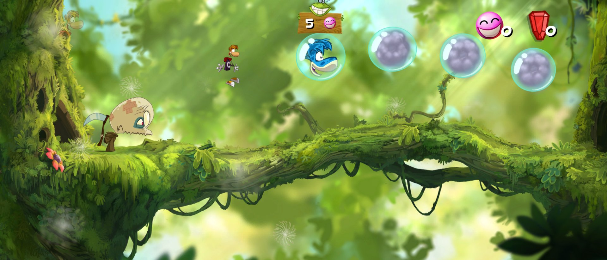

<div align="center">


# Rayman Origins — PC Recomp

**The Windows (Steam/Ubisoft) version of Rayman Origins, statically recompiled to native code.**

Every function of `Rayman Origins.exe` (x86-32, UbiArt Framework) translated to C and compiled for x86-64 and ARM64,
with its own Windows runtime; Direct3D 9 goes to DXVK built as a native library (Vulkan). Linux and Android. No emulation, no Wine,
no FEX, no box64.

</div>

---

> [!IMPORTANT]
> **No game files are included.** This repository has no executables, DLLs, game archives (`.ipk`, `.bik`), shaders,
> recompiled output or artwork of the game. Everything derived from the game is generated on your machine into
> `private/` (git-ignored). You need **your own copy** of Rayman Origins for PC; it is read in place and never modified.

## Why the PC version

The Xbox 360 port ([RaymanOriginsRecomp](https://github.com/BelmanteGu/RaymanOriginsRecomp)) already runs on Android.
This one starts from the **PC build** because that is the copy people can still buy and keep: one install folder
(`Rayman Origins.exe` + `GameData/`, 2.4 GB), no console dump needed.

## Status



| | |
|---|---|
| ✅ **Recompiled** | 45,190 functions of `Rayman Origins.exe`, all lifted to C; x86-64 and arm64 |
| ✅ **Runs on Linux** | title, menus, world map, levels; unattended 30,000-frame run with no stop |
| ✅ **Ultrawide** | Hor+ through UbiArt's own 16/9 pair: 21:9 in a window by default (1920x822) |
| ✅ **60 / 120 fps** | paced Present; 120 = the engine's own logic rate at 120 (real steps, not interpolation) |
| ✅ **Sound and movies** | XAudio2 (PCM, MS ADPCM); Bink movies through FFmpeg, with their soundtrack |
| ✅ **Touch** | on-screen controls and the port's settings drawn in the game (under the game's pause menu) |
| ✅ **Android** | Android 11 or newer, arm64 with Vulkan 1.1 (DXVK); runs on the Galaxy S23, touch controls with the Xbox 360 port's drawings |
| ✅ **Light copy** | the game in 560 MB instead of 2.4 GB (sounds as Opus, the rest byte for byte): [docs/LIGHT_COPY.md](docs/LIGHT_COPY.md) |
| ✅ **Controllers** | any SDL gamepad (USB / Bluetooth) as an XInput pad, plugged before or after start |

Download (Android): [release 1.0](https://github.com/BelmanteGu/RaymanOriginsPCRecomp/releases/tag/v1.0) ·
Log: [docs/PROGRESS.md](docs/PROGRESS.md) · Android: [docs/ANDROID.md](docs/ANDROID.md) · plan:
[docs/PLAN.md](docs/PLAN.md) · rules: [docs/RULES.md](docs/RULES.md)

## The light copy: 2.4 GB → 560 MB

The Steam copy takes 2.37 GB, 1.67 GB of it sounds stored uncompressed. The light copy stores the sounds as Opus
(96 kb/s stereo, 64 kb/s mono: not to be told apart by ear, same length to the sample, loops exact), packs the other
uncompressed files losslessly, keeps everything else byte for byte and leaves out the attract-mode movie. The game
reads it as if it were the original archive.

| | Steam copy | Light copy |
|---|---|---|
| `GameData/bundle_PC.ipk` → `bundle_PC.lite` | 2,093 MB | 473 MB |
| movies (intro, ending, sample) + program | 276 MB | 114 MB |
| **total** | **2.37 GB** | **587 MB** (560 MiB, as phones and `du` show it) |

- **Android:** nothing to do. The launcher makes it once, when the game folder is chosen or at the first Play (about a
  minute on a Galaxy S23), and plays from it. A .zip of the light copy can be kept and imported again later
  (Game files → .zip file), with no new compression.
- **PC:** `sh tools/lite/make_light.sh "<Steam game folder>"` makes it, checks it against the original archive
  (`wrong 0`) and zips it for the phone.

Step by step and how it works: [docs/LIGHT_COPY.md](docs/LIGHT_COPY.md).

## Playing on the PC (Linux)

```sh
sh tools/full_pipeline.sh        # discovery, lift, compile (x86-64 + arm64), runtime: ~10 min the first time
private/build/rayman             # finds the Steam install by itself (or: private/build/rayman <game folder>)
```

| Variable | |
|---|---|
| `RAYMAN_RES=2560x1080` | window size (and so the aspect); otherwise the size chosen in the game's Options, or 1920x822 |
| `RAYMAN_FULLSCREEN=1` | full screen |
| `RAYMAN_FPS=120` | 120 fps (also in the touch settings); `0` = unpaced |
| `RAYMAN_TOUCH=1` | the on-screen controls on the PC (the mouse is a finger) |

## How it works

```
Rayman Origins.exe (x86-32) ──► function discovery ──► lifter ──► C ──► clang ──► x86-64 / ARM64

runtime (C)
 ├─ kernel32, user32, MSVCR90/MSVCP90 (host libc), DirectInput, XInput, XAudio2, WinSock/Quazal (offline) …
 ├─ D3DX9: math, ID3DXEffect; HLSL compiles answered with the game's own precompiled shaders
 ├─ Direct3D 9 ──► DXVK native (PC: 3.1.1; Android: dxvk-native 1.9.2b for Vulkan 1.1) ──► Vulkan
 ├─ binkw32 ──► FFmpeg (Bink video/audio)
 └─ touch layer (controls, port settings) drawn over the frame
```

The pipeline and most of the runtime come from
[UltraStreetFighterIVPCRecomp](https://github.com/BelmanteGu/UltraStreetFighterIVPCRecomp) (same compiler family,
same lifting path; the DXVK bridge comes from the Sonic & All-Stars Racing Transformed PC port). Knowledge of the UbiArt engine (renderer adapter, widescreen, frieze/water quirks, Android
app) comes from the Xbox 360 port.
