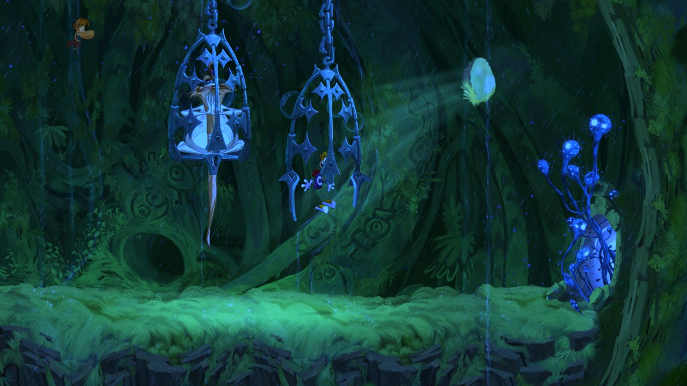
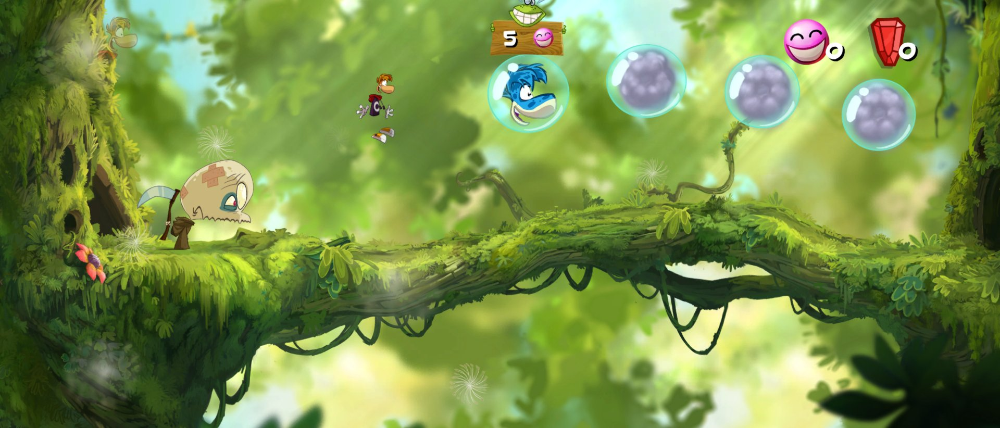
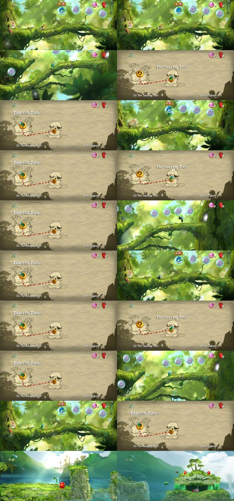

# Progress

## 2026-11-15 — Repository and first read of the executable

Created the repository with the rules, the plan and the tools that carry over unchanged from USFIV-PC
(`check_repo.py`, `pe_info.py`, `term_shot.py`). Read `Rayman Origins.exe` and `GameData/`:
relocations present, dynamic MSVC 2008 runtime, no copy protection, UbiArt engine, shaders shipped as HLSL source.
Details: [studies/pe-analysis-1511.md](studies/pe-analysis-1511.md).

Next: run the game under Proton with a logging `d3dx9_43` to list the effect methods and shader profiles it uses, and
bring over the discovery and lift pipeline (M1).

## 2026-11-15 — M1 + M2: every function lifted, the game boots natively to its title screen at 60 fps

Verified on Linux x86-64 (Intel UHD, Vulkan 1.4), 2026-11-15: `Rayman Origins.exe` runs as recompiled C with our
own runtime, no Wine or Proton, and draws its title screen (animated logo, "Press ENTER") through the D3D9 → Vulkan
layer at 60 fps, ~132 draws per frame.

- **Discovery + lift (M1).** The USFIV-PC pipeline, plus a new seed source: the executable keeps its base
  relocations, and every relocated pointer into code that no function covers is a function start (thread routines
  and callbacks the other heuristics missed). 49,793 functions, 99.9 % of `.text`, all lifted; the C compiles for
  x86-64 and arm64.
- **C runtime.** The game links msvcr90/msvcp90 dynamically; ~190 imports are answered natively (printf/scanf
  formatting from guest arguments, stdio, the x87 `_CIxxx` helpers that take their arguments on the FPU stack,
  start-up, `std::string`). `__sys_nerr` is a function returning a pointer, not data (found by the crash it caused).
- **Shaders without an HLSL compiler.** The game compiles 31 functions of its `*_Register.fx` sources with
  `D3DXCompileShader` at start-up. The archive carries the same functions precompiled
  (`shaders/compiled/win32/<file>_vsh<N>.ckd`, `_psh<N>.ckd`), numbered in the order the game compiles them; every
  one was matched by its constant table (e.g. `renderpct_vsh4` = `default_PCT_Patch_VS`: the only one with
  `g_va0`/`g_va1` and `g_fconst1`). The runtime reads them from `bundle_PC.ipk` (runtime/src/ipk.c).
- **Input.** The game polls `GetKeyState` for all 256 keys and tests `& 0x80`: a pressed key must read as `0xFF80`
  (Windows' real value), not `0x8000`.
- **Settings** live in the registry (`HKCU\Software\Ubisoft\RaymanOrigins\Settings`): a text file in our data folder.

Not done yet: Bink movies (skipped), MS ADPCM sounds (added, not checked by ear), gameplay past the title.

## 2026-11-15 — M3 (first part): gameplay, natively, at 60 fps

Verified on Linux x86-64, 2026-11-15, unattended (`USF_INPUT` presses Enter / Space every 2 s): past the title, the
save notice and the intro, into the first level, with Rayman jumping, rain, light shafts and the HUD drawn right, at
60 fps (~72 draws per frame). The one stop on the way was a second entry point inside an already known function
(`0x90AB20`, reached through a function pointer); the runtime wrote it to `extra_starts.txt` and the pipeline,
now incremental (output files grouped by `.text` range, rebuilt only when they change), took 6.5 minutes.

Next: Bink movies through FFmpeg (the intro is skipped now), checking the sound by ear, a whole level with a pad.

## 2026-11-15 — Ultrawide in a window, 60 fps paced, sound

Verified on Linux x86-64 (1920x1080 144 Hz laptop), 2026-11-15:

- **Ultrawide (Hor+).** UbiArt fits its cameras and screen rectangles to a 16/9, 9/16 pair of floats in `.rdata`
  (`0xA2C1B4`; the Xbox 360 port changes the same pair). At start-up both become A and 1/A, A = the back buffer's
  shape: the view gets wider and the engine places its own HUD (the lums and gems counters at the right edge
  above). The USFIV-PC 2D narrowing and its SSFIV addresses are off.
- **Window.** The game reads `ScreenWidth`, `ScreenHeight` (strings) and `FullScreen` (dword) from its registry key;
  the runtime answers them: 1920x822 (21:9 on a 1920-wide desktop) windowed, `RAYMAN_RES=WxH`,
  `RAYMAN_FULLSCREEN=1`.
- **60 fps on any display.** The game advances one step per presented frame (the 360 port found the same), so
  Present is paced at 60 per second (`RAYMAN_FPS`); a late frame restarts the schedule rather than catching up.
  Without it this 144 Hz screen would run the game 2.4 times too fast.
- **Sound.** XAudio2 with MS ADPCM decoding. 60 s of the mix dumped (`USF_AUDIO_DUMP`): peaks 0.3–0.5, no NaN,
  1,000–6,000 zero crossings per second (music and effects, not noise). Not yet checked by ear.
- **Exit.** The game's shutdown crashes in the destructor of an online-layer object (`0x8F8660`); after the player
  closes the window a fault ends the process normally (saves are made at checkpoints). The cause is still open.

## 2026-11-15 — Discovery from relocations only, Bink movies, real 120 fps, unattended soak

**Discovery.** Two kinds of false function starts were found by looking at why `0x746150` was missed: dwords in
`.data` that only look like code addresses ("vtable" starts at `0x746153`, `0x74616D`, inside the real function),
and relocated jump-table addresses inside instructions (`jmp [eax*4+table]`). Now a data dword is a pointer only if
the linker relocated it, and a relocation in code is a function pointer only as the immediate of `push` / `mov`.
45,190 functions (the 4,600 fewer were false ones); every start the runtime had reported during play
(`0x8BB4A0`, `0x90AB20`, `0x746150`) is now found statically.

**Soak.** `tools/soak.sh`: the game headless with a "monkey" (Enter through menus, then hold right, jump, attack).
30,000 frames (8 min): the first level several times, the world map, a second level; no stop.

**Bink movies.** The game's player was read from its code (0x7FF750..0x7FFAB8): it locks its own L8 textures,
registers them as Bink frame buffers (Y, cR, cB per set at +0x18, 0x30 bytes a set), calls BinkWait / BinkDoFrame /
BinkGetRects every frame and ends when BinkGetSummary's TotalPlayedFrames reaches TotalFrames. hle_bink.c does that
with FFmpeg (it decodes Bink 1, 1280x720 at 29.97 fps, and Bink audio) on a decoding thread, sound on its own SDL
stream. Colors correct (cR = V, cB = U), sound present (peaks 0.39).

**120 fps, real.** The engine has its own frame rates (strings "Game logic 30/50/60fps", "App loop ..."):
`SetFrameRate` (0x796E60) and `SetLogicRate` (0x796E80) write fps and 1/fps to `.data 0xA8A9D8..E4`; the logic step
(`0xA8A9E4`) is read in 65 places. `RAYMAN_FPS=120` sets all four and paces Present at 120: 120 logic steps per
second, not interpolated frames. Checked: the same script at 60 and at 120 fps (every input frame doubled) puts
Rayman in the same place at the same real time (top 60, bottom 120):

## 2026-11-15 — On-screen controls and the port's settings, in the game, by touch

Verified on the PC with the touch layer on (`RAYMAN_TOUCH=1`) and scripted fingers (`USF_TOUCH`), 2026-11-15:

- **In play only the controls show**: a floating stick where the left thumb lands, A (jump), X (attack), B, a RUN
  toggle and a pause button. Fingers become the same pad bits the game already reads (its keyboard through
  `GetKeyState` and its DirectInput pad). Drawn by the runtime: `touch.c` paints an RGBA picture (shapes and a
  built-in 5x7 font), `vk/vk_overlay.c` blends it over the back buffer (one full-screen triangle, premultiplied
  alpha), only re-uploaded when it changes.
- **Pause** sends Esc + Start: the game opens its own pause menu, and the port's settings appear under it, also by
  touch: on-screen controls on/off, size S/M/L, opacity 25/50/75 %, 60 / 120 fps. Kept in `port_settings.txt`
  in the data folder. With the controls off, only the pause button stays (it is the way back to the settings).
- **Resolution** stays where the game has it: the PC build's own Options have a resolution selector, filled from
  `IDirect3D9::EnumAdapterModes`, which the runtime answers.
- Found on the way: the keyboard was also mirrored into the DirectInput pad with USFIV's fighting layout
  (W/A/S/D, J/K/U/I), so a key could count twice; the pad is now the physical gamepad only.

