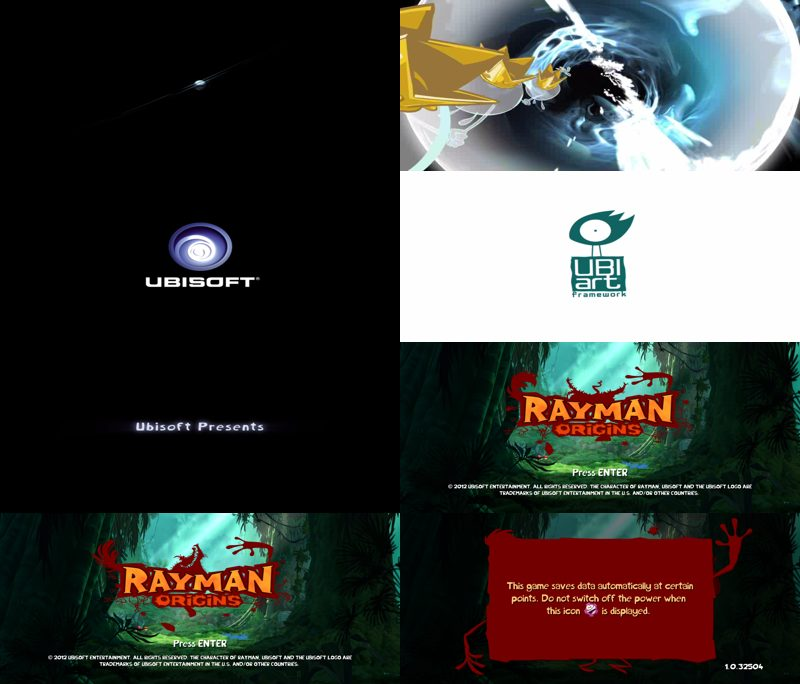
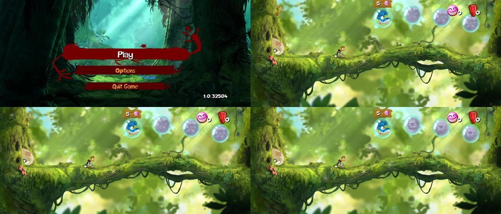
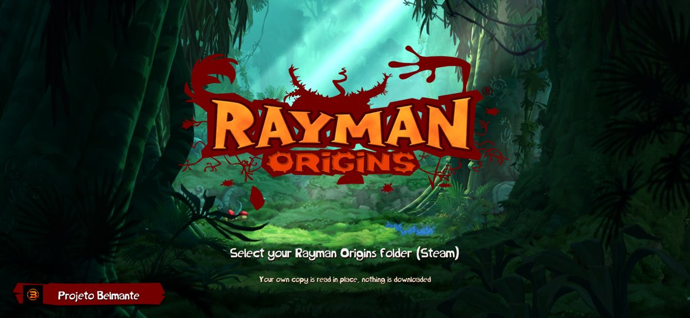
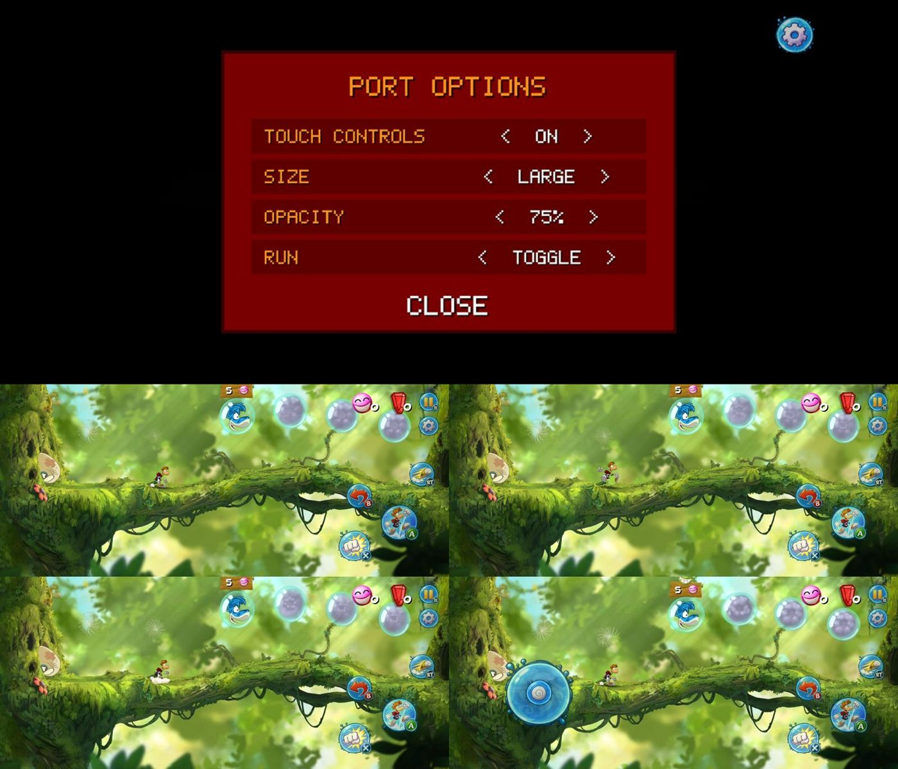
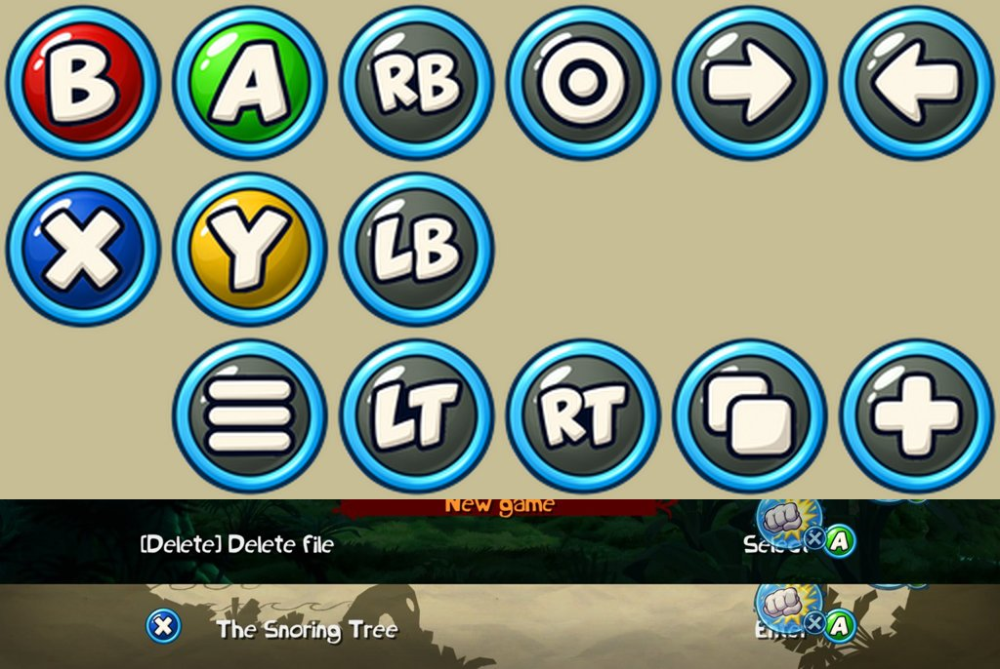
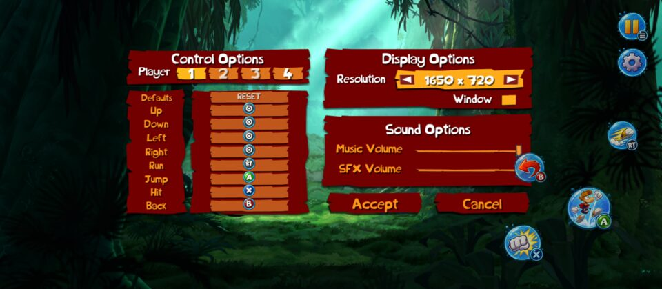

# Progress

## 2026-11-15 — Repository and first read of the executable

Created the repository with the rules, the plan and the tools that carry over unchanged from USFIV-PC
(`check_repo.py`, `pe_info.py`, `term_shot.py`). Read `Rayman Origins.exe` and `GameData/`:
relocations present, dynamic MSVC 2008 runtime, no copy protection, UbiArt engine, shaders shipped as HLSL source.
Details: [studies/pe-analysis-1511.md](studies/pe-analysis-1511.md).

Next: run the game under Proton with a logging `d3dx9_43` to list the effect methods and shader profiles it uses, and
bring over the discovery and lift pipeline (M1).

## 2026-11-15 — M1 + M2: every function lifted, the game boots natively to its title screen at 60 fps

Verified on Linux x86-64 (Intel UHD, Vulkan 1.4), 2026-11-15: `Rayman Origins.exe` runs as recompiled C with our
own runtime, no Wine or Proton, and draws its title screen (animated logo, "Press ENTER") through the D3D9 → Vulkan
layer at 60 fps, ~132 draws per frame.

- **Discovery + lift (M1).** The USFIV-PC pipeline, plus a new seed source: the executable keeps its base
  relocations, and every relocated pointer into code that no function covers is a function start (thread routines
  and callbacks the other heuristics missed). 49,793 functions, 99.9 % of `.text`, all lifted; the C compiles for
  x86-64 and arm64.
- **C runtime.** The game links msvcr90/msvcp90 dynamically; ~190 imports are answered natively (printf/scanf
  formatting from guest arguments, stdio, the x87 `_CIxxx` helpers that take their arguments on the FPU stack,
  start-up, `std::string`). `__sys_nerr` is a function returning a pointer, not data (found by the crash it caused).
- **Shaders without an HLSL compiler.** The game compiles 31 functions of its `*_Register.fx` sources with
  `D3DXCompileShader` at start-up. The archive carries the same functions precompiled
  (`shaders/compiled/win32/<file>_vsh<N>.ckd`, `_psh<N>.ckd`), numbered in the order the game compiles them; every
  one was matched by its constant table (e.g. `renderpct_vsh4` = `default_PCT_Patch_VS`: the only one with
  `g_va0`/`g_va1` and `g_fconst1`). The runtime reads them from `bundle_PC.ipk` (runtime/src/ipk.c).
- **Input.** The game polls `GetKeyState` for all 256 keys and tests `& 0x80`: a pressed key must read as `0xFF80`
  (Windows' real value), not `0x8000`.
- **Settings** live in the registry (`HKCU\Software\Ubisoft\RaymanOrigins\Settings`): a text file in our data folder.

Not done yet: Bink movies (skipped), MS ADPCM sounds (added, not checked by ear), gameplay past the title.

## 2026-11-15 — M3 (first part): gameplay, natively, at 60 fps

Verified on Linux x86-64, 2026-11-15, unattended (`USF_INPUT` presses Enter / Space every 2 s): past the title, the
save notice and the intro, into the first level, with Rayman jumping, rain, light shafts and the HUD drawn right, at
60 fps (~72 draws per frame). The one stop on the way was a second entry point inside an already known function
(`0x90AB20`, reached through a function pointer); the runtime wrote it to `extra_starts.txt` and the pipeline,
now incremental (output files grouped by `.text` range, rebuilt only when they change), took 6.5 minutes.

Next: Bink movies through FFmpeg (the intro is skipped now), checking the sound by ear, a whole level with a pad.

## 2026-11-15 — Ultrawide in a window, 60 fps paced, sound

Verified on Linux x86-64 (1920x1080 144 Hz laptop), 2026-11-15:

- **Ultrawide (Hor+).** UbiArt fits its cameras and screen rectangles to a 16/9, 9/16 pair of floats in `.rdata`
  (`0xA2C1B4`; the Xbox 360 port changes the same pair). At start-up both become A and 1/A, A = the back buffer's
  shape: the view gets wider and the engine places its own HUD (the lums and gems counters at the right edge
  above). The USFIV-PC 2D narrowing and its SSFIV addresses are off.
- **Window.** The game reads `ScreenWidth`, `ScreenHeight` (strings) and `FullScreen` (dword) from its registry key;
  the runtime answers them: 1920x822 (21:9 on a 1920-wide desktop) windowed, `RAYMAN_RES=WxH`,
  `RAYMAN_FULLSCREEN=1`.
- **60 fps on any display.** The game advances one step per presented frame (the 360 port found the same), so
  Present is paced at 60 per second (`RAYMAN_FPS`); a late frame restarts the schedule rather than catching up.
  Without it this 144 Hz screen would run the game 2.4 times too fast.
- **Sound.** XAudio2 with MS ADPCM decoding. 60 s of the mix dumped (`USF_AUDIO_DUMP`): peaks 0.3–0.5, no NaN,
  1,000–6,000 zero crossings per second (music and effects, not noise). Not yet checked by ear.
- **Exit.** The game's shutdown crashes in the destructor of an online-layer object (`0x8F8660`); after the player
  closes the window a fault ends the process normally (saves are made at checkpoints). The cause is still open.

## 2026-11-15 — Discovery from relocations only, Bink movies, real 120 fps, unattended soak

**Discovery.** Two kinds of false function starts were found by looking at why `0x746150` was missed: dwords in
`.data` that only look like code addresses ("vtable" starts at `0x746153`, `0x74616D`, inside the real function),
and relocated jump-table addresses inside instructions (`jmp [eax*4+table]`). Now a data dword is a pointer only if
the linker relocated it, and a relocation in code is a function pointer only as the immediate of `push` / `mov`.
45,190 functions (the 4,600 fewer were false ones); every start the runtime had reported during play
(`0x8BB4A0`, `0x90AB20`, `0x746150`) is now found statically.

**Soak.** `tools/soak.sh`: the game headless with a "monkey" (Enter through menus, then hold right, jump, attack).
30,000 frames (8 min): the first level several times, the world map, a second level; no stop.

**Bink movies.** The game's player was read from its code (0x7FF750..0x7FFAB8): it locks its own L8 textures,
registers them as Bink frame buffers (Y, cR, cB per set at +0x18, 0x30 bytes a set), calls BinkWait / BinkDoFrame /
BinkGetRects every frame and ends when BinkGetSummary's TotalPlayedFrames reaches TotalFrames. hle_bink.c does that
with FFmpeg (it decodes Bink 1, 1280x720 at 29.97 fps, and Bink audio) on a decoding thread, sound on its own SDL
stream. Colors correct (cR = V, cB = U), sound present (peaks 0.39).

**120 fps, real.** The engine has its own frame rates (strings "Game logic 30/50/60fps", "App loop ..."):
`SetFrameRate` (0x796E60) and `SetLogicRate` (0x796E80) write fps and 1/fps to `.data 0xA8A9D8..E4`; the logic step
(`0xA8A9E4`) is read in 65 places. `RAYMAN_FPS=120` sets all four and paces Present at 120: 120 logic steps per
second, not interpolated frames. Checked: the same script at 60 and at 120 fps (every input frame doubled) puts
Rayman in the same place at the same real time (top 60, bottom 120):

## 2026-11-15 — On-screen controls and the port's settings, in the game, by touch

Verified on the PC with the touch layer on (`RAYMAN_TOUCH=1`) and scripted fingers (`USF_TOUCH`), 2026-11-15:

- **In play only the controls show**: a floating stick where the left thumb lands, A (jump), X (attack), B, a RUN
  toggle and a pause button. Fingers become the same pad bits the game already reads (its keyboard through
  `GetKeyState` and its DirectInput pad). Drawn by the runtime: `touch.c` paints an RGBA picture (shapes and a
  built-in 5x7 font), `vk/vk_overlay.c` blends it over the back buffer (one full-screen triangle, premultiplied
  alpha), only re-uploaded when it changes.
- **Pause** sends Esc + Start: the game opens its own pause menu, and the port's settings appear under it, also by
  touch: on-screen controls on/off, size S/M/L, opacity 25/50/75 %, 60 / 120 fps. Kept in `port_settings.txt`
  in the data folder. With the controls off, only the pause button stays (it is the way back to the settings).
- **Resolution** stays where the game has it: the PC build's own Options have a resolution selector, filled from
  `IDirect3D9::EnumAdapterModes`, which the runtime answers.
- Found on the way: the keyboard was also mirrored into the DirectInput pad with USFIV's fighting layout
  (W/A/S/D, J/K/U/I), so a key could count twice; the pad is now the physical gamepad only.

## 2026-11-15 — Android build; settings change live; a note on measurements

- Android: `tools/android/build_ffmpeg.sh` (Bink only), `build_native.sh`, `build_apk.sh` produce
  `rayman-origins-pc.apk` (arm64, signed, verified; no unresolved strong symbols). Not run on a phone: none was
  connected. See [ANDROID.md](ANDROID.md).
- The fps setting is read every frame, so 60 / 120 from the touch settings applies at once (it was read only at
  start-up).
- A 50,000-frame soak ran at ~16 fps and a later check at ~37 fps: three USFIV-PC test runs of another session were
  using the CPU and the shared GPU at the same time. With the machine free the same runs hold 60 fps (earlier
  entries). Measurements are only meaningful on an idle machine.

## 2026-11-15 — USB / Bluetooth controllers: the game reads them as XInput pads

- Report: a USB pad (a generic "Zikway HID gamepad") did nothing in the game, although SDL saw it and its buttons
  reached the DirectInput device (`USF_PADLOG=1` shows them).
- Cause, in the game's code: the pad manager (vtable 0x9F1ED8) enumerates DirectInput game controllers and first
  asks **WMI** for PnP devices whose DeviceID has `IG_` (Microsoft's IsXInputDevice sample, 0x4B60C0). A pad whose
  guidProduct matches one of them is an XInput pad (read with `XInputGetState`, 0x4B6C60); any other is read with
  DirectInput. The default controls (0x4B4F91) are set **only for XInput pads**: a DirectInput pad has no mapping
  and is ignored. Our CoCreateInstance had no WMI, so no pad was ever XInput and `XInputGetState` was never called.
- Fix: `hle_wmi.c` answers `CLSID_WbemLocator` with one Win32_PNPEntity of an Xbox 360 pad
  (`VID_045E&PID_028E&IG_00`), and the DirectInput pad carries that guidProduct. The game now reads player 1 with
  `XInputGetState(0)`, which is any SDL gamepad (Xbox, PlayStation, Switch, generic), plugged before or after start.
- With an XInput pad the game no longer reads the keyboard itself, so the keyboard is folded into pad 0 in the
  game's PC layout: arrows, Space / Enter = jump / confirm, S = attack, Shift = run, Backspace = back, Esc = pause.
- Checked: a 6,000-frame scripted run reaches a level and plays through the XInput path only.

## 2026-11-19 — Direct3D 9 through DXVK native (the renderer from now on)

- The own D3D9 → Vulkan layer stuttered (frames of 90+ ms). As in the Sonic & All-Stars Racing Transformed PC port,
  the game's Direct3D 9 now goes to **DXVK 3.1.1 built as a native Linux library** (`private/deps/dxvk`,
  `build-native`, D3D9 only, SDL3 window system). The bridge (`runtime/src/d3d9/dxvk_bridge.c`, `dxvk_sigs.c`,
  `dxvk_d3dx.c`, from that port; `dxvk_glue.c` for this runtime) wraps each DXVK object in a guest object, converts
  arguments by each method's signature and hands locks a guest copy.
- Kept from this port: Hor+ aspect at CreateDevice / Reset, the 60 / 120 fps pacer and engine rates after Present
  (DXVK's limiter off), `D3DXCreateTexture` through the device (DXT sizes rounded up to 4x4 blocks as D3DX does: DXVK
  refuses a 2x1 DXT1 texture, and the game then crashed on the null texture), `D3DXLoadSurfaceFromMemory` through
  LockRect.
- Verified (headless): Bink logos, menu, first level at 21:9; the RTX 3050 is used (the own layer only saw the Intel).
- **Frame times**, level, 120 fps, power-saver, same scripted input (`RAYMAN_FTLOG`):

  | | own renderer | DXVK |
  |---|---|---|
  | mean fps | 115.9 | 119.0 |
  | frame-time std dev | 2.72 ms | 0.91 ms |
  | p99 | 15.6 ms | 11.0 ms |
  | worst | 93.5 ms | 17.9 ms |
  | frames over 16.7 ms | 24 | 4 |

## 2026-11-19 — Touch controls with the Xbox 360 port's drawings, drawn through DXVK

- The on-screen controls now use the themed drawings made for the Xbox 360 port (jump, attack, back, run, pause, stick
  base and knob; `runtime/assets/touch/`). `tools/touch_art.py` scales them to 256x256 premultiplied RGBA
  (`private/include/touch_art.rgba`, made by the build scripts) and `touch_art.c` embeds that block; `touch.c` draws
  them bilinear, lighter and a little smaller while pressed. Opacity steps are now 50 / 75 / 100 %.
- The layer is blended by `dxvk_overlay.c`: on DXVK's device, a dynamic texture refilled only when the picture changes
  and one fixed-function quad before Present, with the game's state saved in a state block and its render target and
  depth buffer put back.

## 2026-11-19 — Android with DXVK: runs on the Galaxy S23

- The APK now carries `libdxvk_d3d9.so` built by `tools/android/build_dxvk_mobile.sh` (dxvk-native 1.9.2b with
  mobile-GPU patches, SDL3 window system, Vulkan 1.1; the build the Sonic & All-Stars Racing Transformed port runs on
  the S23). The runtime loads it next to `libmain.so` through the same bridge as on the PC.
- Installed on the Galaxy S23 with the game folder in `Games/RaymanOrigins`: **the user played it, it runs well**,
  with the drawn touch controls.

## 2026-11-22 — A launcher in the game's own look (HTML mock-up)

- Studied the PC build's title menu (`scene/menus/mainmenu`: buttons from the `bubblemenu_a` atlas animated by a
  skeleton, the scene `menumainbackground_v2`) and its Options screen (`scene/menus/inputconfiguration`: plain 2D
  textures for panels, fields, arrows, sliders, check box; text in `font02.fnt`).
- `USF_HIDE_TEX=<w>x<h>x<format>,...` (analysis, in the DXVK bridge) skips draws whose stage-0 texture matches: with
  the menu atlas (1024x512 DXT3) and the font (1024x1024 DXT3) hidden, the game renders the jungle behind its menu,
  and with only the font hidden, the bars without text. The captures (2340x1080, the S23's shape) are deterministic,
  so bars minus scene gives each carousel slot as a picture.
- `tools/launcher_mock.py` + `tools/launcher_mock.html` build `private/launcher/launcher.html` (game pictures from the
  user's copy, so it stays in private/): the home is the game's scrolling bars with the port's entries (Play, Options,
  Game files, Quit Game); the settings are the game's Options screen with the port's settings (touch controls size,
  opacity, stick, run, vibration...; resolution, 120 fps; volumes; Accept / Cancel). Keyboard, mouse and touch.
  Positions are measured on the game's own screens; text uses the game's font and colours.

## 2026-11-22 — The launcher mock-up plays the game's own animations (no recording)

- The title logo and the menu's bars are UbiArt skeleton animations: pieces of an atlas, each drawn as a cubic Bezier
  patch by the game's `default_PCT_Patch_VS` (the HLSL is in the archive, `shaders/unified/renderpct.fx`): 8 control
  points per patch (position xy, UV zw) from c17, corner colours from c145, the matrix in c0..c3.
- `USF_GEO_DUMP=<file>` + `USF_GEO_TEX=#<hash>,...` (`runtime/src/d3d9/dxvk_geodump.c`) writes, for each draw of
  those textures, the constants and the patch grid. Textures are named by a hash of their level 0 (taken at Unlock,
  through GetSurfaceLevel and UpdateTexture too); `USF_HIDE_PS` / `USF_HIDE_TEX(_ODD)` / `USF_SHOT_RUN` are the other
  capture aids.
- `tools/geo_anim.py` turns a dump into one loop (logo: 121 frames, bars: 90, found where the patches repeat
  exactly), 30 frames a second, gzip: 224 KB and 74 KB. The mock-up evaluates the same Bezier patches in WebGL over the
  game's atlases, so the animation is the game's, sharp at any size.
- Mock-up now: the title screen (animated logo) asks for the Steam folder; the menu with the animated bars and hand;
  the settings with a Language row; the menu theme (`sound/300_music/310_common/mus_menu_main.wav`, from the archive,
  looped); "Projeto Belmante" with the channel logo at the bottom left. App icon: `runtime/assets/app_icon.png` (fan
  art from SteamGridDB, chosen by the user).
- Seen on the way: the NVIDIA driver failed (kernel `NVRM` RPC errors, `VK_ERROR_DEVICE_LOST` in DXVK, GPU gone until a
  reboot); the captures were finished on the Intel GPU (`VK_ICD_FILENAMES=.../intel_icd.json`).

## 2026-11-22 — Android launcher in Java in the game's look; language; crash reports

- **Launcher** (`GameMenu.java`, `MenuArt.java`, `MenuText.java`; no WebView): a View drawing a 2340x1080 stage scaled
  to the screen. Title screen with the game's animated logo asking for the Steam folder; the menu with the animated
  bars and hand (Play, Options, Game files, Quit Game); the settings on the game's Options screen; the menu theme in a
  loop (MediaPlayer); "Projeto Belmante" on the game's red plank. The animations are the game's Bezier patches drawn
  with `Canvas.drawVertices` over the atlases; text in the game's font. Touch, pad (d-pad, A/Start, B/Back) or keys.
  Its art comes from the player's copy (`tools/launcher_mock.py` writes `private/launcher/apk/launcher/`;
  `build_apk.sh` packs it: personal builds); without it the plain launcher stays. App icon: `runtime/assets/app_icon.png`.
- **Settings** go to `port_settings.txt` (the launcher keeps the runtime's own keys and vice versa): touch / size /
  opacity (touch.c), `lines` (the resolution, hle_advapi.c), `lang`, volumes, stick, run, vibration...; 120 fps hidden.
- **Language**: the game reads `HKLM\SOFTWARE\Ubisoft\RaymanOrigins\Settings\Language` (a DWORD, its own numbers:
  `localisation.loc` has 0 en, 1 fr, 2 ja, 3 de, 4 es, 5 it, 8 pt, 10 pl, 11 ru, 12 nl, 13 cs, 14 hu); the runtime
  answers it from `lang=`. Checked: lang French -> the title reads "Appuie sur ENTRÉE.". The launcher's own texts follow
  (8 translations; Czech, Hungarian and Japanese show English there).
- **Crash on the phone** (a level closed by itself): Android's exit info shows the game process killed by SIGSEGV
  (rss 1.5 GB), with no tombstone, because the runtime's fault handler reset the signal to the default. Now a fault
  is written to logcat and `<data>/crash.txt` (native pc, lifted function, stack) and then handed to Android's own
  handler (tombstone). The cause itself needs that report from the next crash.

## 2026-11-22 — The crash at level loads found and fixed; button icons in texts

- **Crash** (the phone's "a level just closed", SIGSEGV): reproduced on the PC with the new crash report, 2 runs in 3
  at the title: the texture loader thread (0x8BB4A0 → 0x4BF2D0 → `f_004B9960`) calls a texture's GetLevelDesc through
  a corrupted vtable. The DXVK bridge gave a released object's 16-byte guest wrapper back to the heap; reused, it was
  overwritten while still referenced across the loader and render threads. Keeping released wrappers (16 bytes each)
  : 0 crashes in 7 runs (and no call on a released object seen; such a call now fails cleanly and is logged).
  `USF_DXB_FREE=1` restores the old behaviour for comparisons.
- **Crash reports**: on the PC too the report names the lifted function (`-rdynamic`) or module + offset.
- **Button icons**: the texts carry `[icon:X360_BUTTON_A]`; the PC build rewrites each as "[" + the pad manager's name
  for it + "]" (method 17 at 0x4B66E0, called from 0x7A72A0), hence "[1-A Button]". `pad_icons.c` answers method 17:
  with a pad in use (an SDL gamepad, or the touch layer) it returns "icon:<name>", so the tag survives and the text
  draws the pad button's picture; keyboard only, the key's name stays. `USF_PAD_ICONS=1` forces it (tests). Not yet
  checked on screen: the machine was busy with other builds.

## 2026-11-22 — The crash's real cause: stale surface wrappers in the DXVK bridge

- Keeping released wrappers (previous entry) did not fix it: the same crash came back (2 of 2 runs to the world map).
  The texture pointer the loader read was 1, not a corrupted pointer. With the own renderer (`USF_DXVK=0`) the same
  runs never crash, so the cause was in the bridge.
- Cause: a texture level's surface (GetSurfaceLevel) has the texture's reference count in DXVK, so its wrapper never
  saw a final Release and outlived the texture. When DXVK later put another object at the same address, the bridge
  found the old wrapper and handed the game an object of the wrong kind.
- Fix: a texture's (cube's, volume texture's) level wrappers are detached when it is released, and a wrapper found
  for an address with another kind of object is replaced. 4 of 4 runs of 90 s to the world map, no crash (before:
  a crash in the first 30 s).
- Button icons: method 16 (an action's binding name, 0x4B7080) and method 17 are answered with icon tags when a pad
  is in use (the binding is read from the pad manager's tables, so it works in every language). The world map's
  hints still show "[1-X Button]": they are built another way, still being traced.

## 2026-11-22 — Touch jumps again; the game's pause and the port's menu are separate buttons

- **"Can't jump" (Galaxy A56)**: since the game sees an XInput pad (hle_wmi.c, for USB controllers) it reads player 1
  only from XInput, but the on-screen controls were fed as keys and DirectInput. Menus still answered (keys, mouse
  from touch), play did not. The touch bits now go to player 1's XInput state, and only there (as keys too, one tap
  could count twice): A B X Y and the d-pad as they are, pause = Start, run = RT, the floating stick also as the left
  stick. Checked on the PC with scripted fingers: a touch on A in a level makes Rayman jump.
- **Two buttons at the top right**: pause (the game's own pause menu, Start) and, under it, a gear (the drawing made
  for the X360 port) that opens the **port's menu**. Before, one button did both and the port's bar guessed whether
  the game was paused, so it could stay on screen and eat taps.
- **The port's menu** is a panel in the game's pause-board red: touch controls on/off, size, opacity, run (toggle or
  hold, the launcher's `runhold`), close; in the launcher's language (en fr de es it pt; the others in English); the
  120 fps entry is gone (hidden, as asked). A tap outside or on the gear closes it; the game gets no touch input
  while it is open.
- Launcher: the adb development intent (`--es game <folder> --ez play true`) was skipped by the new menu; fixed. Tested
  on a Galaxy A56 (Exynos 1580, Xclipse 540): menu and first level at 60 fps, no crash.

## 2026-11-22 — Controller buttons in the game's hints; the port's menu over the game

- **"Enter [1-A Button]" → a button picture.** The menus' hints take the button's name from the pad manager's
  method 18 (0x4B71A0: confirm / back / delete... as player 1's actions 9, 4, 2, 10) and method 19 (0x4B7380);
  with a pad or the touch layer they now answer an icon tag (`pad_icons.c`, like methods 16 and 17).
- **The pictures.** The PC build's atlas for those tags (`consoles_buttons/x360/x360_pad_buttons.tga`, 512x256, 6 x 3
  cells named in `uitextconfig.isg`) holds *keyboard keys* ("DELETE", "F1", arrows, Rayman for Space), and the game
  makes it A8B8G8R8 from A8R8G8B8 pixels (red and blue swapped: Rayman's hair showed blue). The runtime now writes
  Xbox-style buttons into its cells as the game fills each level (through GetSurfaceLevel + LockRect: hooked at the
  bridge's unlock, `dxvk_locks.c`); the atlas is known by the hash of its first 4 KB. The mosquito, the steps and the
  empty cells stay the game's.
- **The art** (`runtime/assets/pad_icons.png`, made by `tools/pad_icons_art.py --draw`): one generated empty
  button (glossy ball in a light blue ring, dark blue rim) tinted per button (A green, B red, X blue, Y yellow, the
  rest graphite) and a generated sheet of symbols in the touch controls' lettering, cut from their white
  (`private/padicons/gen/`, kept out of git; the PNG made from them is ours). The build turns the PNG into its 10
  RGBA levels (`private/include/pad_icons.rgba`, embedded by `pad_icons_art.c`).
- **The port's menu over the game** (Android): the gear opens the launcher's own Options screen (`GameMenu` in an
  in-game mode) over the dimmed game, which is held still meanwhile (`port_android.c` → `game_pace`). Its last row
  becomes **Button layout: Edit** (the buttons can then be dragged on the game's screen; RESET / DONE; kept as
  `b<i>x`/`b<i>y` in `port_settings.txt`), and a plank at the bottom right goes **back to the launcher** (the game's
  process ends). The launcher's options now act in the game too: fixed or floating stick, pad hides the touch
  controls, show FPS, vibration (haptics through `GameActivity.haptic`).

## 2026-11-22 — The light copy of the game: 2.4 GB → about 0.6 GB

What the 2.4 GB are: `bundle_PC.ipk` 2.1 GB, of which **1.67 GB is uncompressed PCM audio** (16-bit, 48 kHz:
music, voices, effects), 306 MB files the game already keeps zlib'd (textures, animations, scenes), 115 MB other
uncompressed files; and 268 MB of Bink movies, 162 MB of them the attract-mode reel (`rolling_demo.bik`).

- **`bundle_PC.lite`** (`runtime/src/lite.h`, `lite_make.c`): the archive cut into its files and the gaps between
  them; every 16-bit 48 kHz PCM WAVE becomes **Opus** (CELT, 96 kb/s stereo / 64 kb/s mono, 20 ms frames, VBR,
  complexity 10; header and trailing chunks kept as they are, the exact number of samples), other uncompressed files
  zlib level 9 when that saves a tenth, the rest as it is. 2,093 MB → **473 MB** (sounds 1,672 → 111 MB) in 46 s on
  the PC (4 threads).
- **The game does not know** (`lite_read.c`): where the archive is missing and `bundle_PC.lite` is there, the file
  layer (`CreateFile`, `ReadFile`, `SetFilePointer`, sizes, attributes, find-first/next) and the C runtime's
  `_waccess_s` / `_stat` (the game checks the archive exists that way) answer with the original archive's bytes at
  the original offsets. Sounds are decoded progressively, as far as the game has read plus half a second (music is
  streamed), into a 96 MB cache.
- **Checked** (`tools/lite/lite_check.c`): all 13,447 regions give back the original bytes except the sounds' samples;
  the sounds have the same headers and lengths and are aligned to the sample (a first try with SILK for mono came out
  2 samples early: CELT only now). Reading the 48 biggest sounds in 8 KB pieces gives the same bytes as reading them
  whole. The game ran from the light copy to a level with its music and effects; making the sounds back cost about
  0.5 s in all.
- **Movies**: the attract reel is left out; a missing movie makes BinkOpen answer "no movie" and the game goes on
  (idle 100 s on the title: never asked for). The intro and ending stay as they are (Bink is already compressed).
- **Android**: `libpack.so` (`runtime/android/pack_jni.c` + `lite_make.c` + libopus built by
  `tools/android/build_opus.sh`) and `Packer.java`: once, when the Steam folder is chosen or at the first Play, the
  launcher makes `game_lite/` in the app's folder (program, `bundle_PC.lite`, intro / ending / sample movies), shows
  the progress over the menu, and plays from it; a copy that was already inside the app's folder is then removed.
- Not done: recompressing the textures the game keeps zlib'd with something stronger (xz would save about 80 MB
  more, but the game wants zlib: they would have to be re-deflated at every load, slower levels on a phone).

Total on the phone: 473 MB archive + 106 MB movies + 8 MB program ≈ **0.59 GB** instead of 2.37 GB.

On the S23 the launcher made it in about a minute (6 threads); that copy, pulled back, checks exact (13,447 regions,
0 wrong). **Import as .zip** in the game-look launcher too: "Game files" (and the title screen) asks for a folder or a
.zip. A .zip of the light copy (a folder with the program and `GameData/bundle_PC.lite` + movies; stored, ~0.59 GB)
becomes `game_lite/` as it is, so a player can keep it and reinstall without making it again; a .zip of the whole
game is extracted, made light, and the extracted files removed.

## 2026-11-22 — Version 1.0, and the light copy's step by step

- Release **1.0** on GitHub (the Android APK; private: the APK carries the menu's art and music from the game).
  Version 1.0 / code 2 in the APK and on the launcher.
- [LIGHT_COPY.md](LIGHT_COPY.md): the step by step of the light copy, on the phone (by the launcher, keeping it as a
  .zip) and on the PC: `tools/lite/make_light.sh <Steam folder>` builds the tools, makes the copy, checks it and
  zips it for the phone's import.

## 2026-11-22 — Phones without DXT textures (Redmi 10C, Adreno 610)

The game crashed at once on a Redmi 10C: its GPU (Adreno 610) has no BC formats in Vulkan, so DXVK could not make
the game's first DXT1 texture (`D3DXCreateTexture ... format DXT1 -> D3DERR_OUTOFVIDEOMEMORY`) and the game wrote
into the texture it did not get. `runtime/src/d3d9/dxvk_bcemu.c`: when DXVK's `CheckDeviceFormat` says no DXT1 (or
`USF_BC_EMU=1`), DXT textures and surfaces are made as A8B8G8R8; the game still sees DXT (level descriptions, its
lock pitch and guest copy, `CheckDeviceFormat`), and each Unlock decodes the locked blocks into DXVK's level with the
old renderer's decoder (`vk/vk_bcdec.c`); DDS files likewise. Checked on the PC with `USF_BC_EMU=1` (the title the
same as with BC) and on the Redmi (menus, ~15-18 fps). GPUs with BC (S23, A56, the PC) are unchanged.

Found on the way: on the PC, a light copy given by a relative path is not found (the game falls back to loose
files and crashes); an absolute path works (the Android app always gives one). Not fixed yet.

## 2026-11-23 — Weak phones: the waits and the CPU (Redmi 10C, Adreno 610)

The Redmi 10C ran the menus at ~30 fps. Measured on the phone with simpleperf (the app is now `profileable` for
the shell) and on the PC with a new sampler (`USF_PROF=<s>`, `USF_PROF_WAIT=<s>`, runtime/src/prof.c):

- **A third of the game thread waited for the GPU** (`D3D9DeviceEx::WaitForResource`, spinning on `sched_yield`).
  `USF_LOCKSTATS=1` (each lock tried first with DONOTWAIT) found them: the sprite batches' small vertex buffers
  (96 B - 3 KB, DYNAMIC | WRITEONLY, default pool) locked with no flags, hundreds of times a second. dxvk-native
  1.9.2b maps such buffers directly, so a lock without DISCARD waits for the GPU; the PC's GPU is always done by then,
  the Adreno 610 is not. The bridge keeps a whole guest copy of every buffer, so such a lock now takes a fresh slice
  (DISCARD) and Unlock copies the whole copy (≤ 64 KB). `USF_NO_SMALL_DISCARD=1` restores the old way.
- **getenv on every Direct3D call**: the bridge read its analysis switches per call (14% of the game thread in
  getenv and much of another 20% in libc's compares). They are read once now, and the runtime's getenv answers from a
  table (env_cache.c, invalidated by its own setenv).
- **Indirect calls**: each virtual call binary-searched 45,190 functions (10% of the game thread); a direct-mapped
  cache of 64K slots in front (dispatch.c) leaves 3.7%.
- Tests: the scripted input (`USF_INPUT`) is parsed once (it was parsed at every pad read, and dominated the soak's
  profile); the game folder is made absolute before the runtime changes directory (a relative light-copy folder
  was not found on the PC).

Title screen on the PC: 4.8 → 3.0 ms of CPU a frame; in a level (soak): 7-10 → 3.1-3.3 ms, 60 fps, no late frame.
Research on other DXVK ports (Skyrim_Android, LMS_Android, spore-re, nfsu2-recompiled): they all keep
dxvk-native 1.9.2b / 1.10.3 for Vulkan 1.1, decode DXT on the CPU, and load Turnip / PanVK drivers through
adrenotools for old Adreno and Mali; dxvk 1.10.3 waits without spinning and synchronizes only up to the resource's
last use (a candidate rebase), and has `d3d9.allowDirectBufferMapping` (not in 1.9.2b).

Then, measured on the Redmi again (simpleperf with off-CPU time): the game thread used 12-17 ms of CPU a frame and
spent the rest blocked in DXVK's Present (`waitForSubmission`), its submit thread in Android's `queueBuffer` (the
display's 60 Hz); a frame over ~16 ms misses the vsync and the game drops to 30 fps. The touch layer took a tenth of
the game thread: the buttons were rasterised into a picture of the whole screen (4.7 MB) and uploaded at every
finger move. Now `dxvk_overlay.c` draws them as textured quads from a 2048x256 atlas of the 8 drawings (with mips,
made once); the picture is kept for shapes and text only (menu, editor, fps) and is empty in play. Same look
(compared on the PC with `RAYMAN_TOUCH=1`).

**The real cause of the 30 fps on the Redmi:** dxvk-native 1.9.2b reads no `DXVK_CONFIG` variable (only a file:
`DXVK_CONFIG_FILE` or `./dxvk.conf`), so on Android none of the bridge's DXVK options applied: the game's own vsync
request won and DXVK recreated the swap chain in FIFO; with its synchronous present, any frame over 16.7 ms waited
for the next vblank and the game fell to 30 fps (the PC's DXVK 3.1.1 reads the variable: never seen there). The
bridge now also writes the options to `<data>/dxvk.conf` and points `DXVK_CONFIG_FILE` at it, with
`d3d9.tearFree = True` (MAILBOX, never IMMEDIATE). Checked on the Redmi: "Found config file", presentInterval 0,
MAILBOX kept.

## 2026-11-24 — Turnip and BCeNabler on Android (libadrenotools)

- **GPU driver of the player's**: Game files → GPU driver → System / Turnip. The launcher (GpuDrivers.java) downloads
  Turnip from GitHub (pinned: StevenMXZ `Turnip_v26.3.0-R6.zip`, Mesa 26.3: before 26.3 Turnip offers only Vulkan 1.0
  on an Adreno 610, Mesa MR !43117 added the missing multiview) into files/gpu_drivers/turnip/; the runtime
  (gpu_driver.c) opens it through libadrenotools (tools/android/build_adrenotools.sh; hook libraries beside
  libmain.so) and gives DXVK its vkGetInstanceProcAddr as `DXVK_VK_GIPA` (tools/android/dxvk_mobile_gipa.patch);
  the window surface already comes from the instance's own vkCreateAndroidSurfaceKHR. A trial file sends a driver
  that never draws back to the system's (the MHGU port's scheme).
- **BCeNabler** (libadrenotools) on the system's Qualcomm driver: drivers 512.x before 514 hide the BC formats the
  Adreno 6xx has; patched, DXT textures stay compressed (USF_NO_BCN=1 leaves it alone).
- The "Fullscreen mode not supported" message box no longer stops every start (the game asks for an exclusive mode
  a phone does not have; DXVK's desktop full screen is what is wanted).
- Input recording for repeatable tests: `USF_REC=<file>` / `USF_REPLAY=<file>` (player 1 as the game received it).
- **Redmi 10C with Turnip 26.3** (the user, 2026-11-24): "Turnip Adreno (TM) 610", `textureCompressionBC: 1` (the
  game's DXT textures as they are), the driver's trial passed; some visual errors of the Qualcomm driver are gone. In
  a level still 28-37 fps at 1232x540 (CPU 11-15 ms a frame, target 60): GPU-bound, still to be found.

## 2026-11-24 — Frameskip

The game advances one step per presented frame, so a phone that draws 35 frames a second played it at 58% speed
(the Redmi 10C's "slow"). Frameskip (launcher Options → Display, a check box; on by default on Android,
`USF_FRAMESKIP=0/1`): `game_pace` catches lost steps up (up to 4 frames behind) instead of starting again from now,
and a frame that leaves the game behind the clock makes the next one run undrawn: the DXVK bridge sends none of its
GPU work (draws, clears, surface copies, Present) while state, uploads and locks still go to DXVK. One in a row at
most: three left only one frame in four drawn on the Redmi (15 drawn / 45 skipped a second, `USF_SKIPLOG=1`), as each
drawn frame's ~30 ms of GPU kept the game behind. With one: the game at 60 steps a second, the picture at ~30.
`USF_TEST_SLOW_MS=<ms>` slows each drawn frame (tests on the PC). The GPU time itself (~30 ms a frame at 1232x540 on
the Adreno 610) is still to be explained.

## 2026-11-24 — What the Adreno 610's frame costs (measured on the Redmi 10C), and options

Tools added (all off unless asked for):
- `DXVK_PASSLOG=1` (tools/android/dxvk_mobile_passlog.patch): render passes a second by kind (size, attachments,
  load ops, depth attached / used, draws a pass). In a level: one scene pass (~175 draws, depth attached and loaded
  but never used), one pass of the touch layer that reloads the back buffer, DXVK's blit to the screen.
- `USF_NO_DEPTH=1`: no depth buffer at all (same picture). On the Redmi: no change (27.5 → 27-28.7 fps): not it.
- `RAYMAN_RES=616x270` (a quarter of the pixels): 27.5 → a steady 60 fps, the CPU 18 → 12 ms: the cost is per pixel,
  on the GPU.
- `USF_SIMPLE_PS=1` (every pixel shader `texld; mov`): 27.5 → 36-39 fps, the picture wrong: shaders are part of it.
- `USF_PS_ROTATE=<frame>` (dxvk_psrot.c): windows with one pixel shader left out at a time. The sprite shader
  (`texld; mul by the vertex colour`, most of the scene's draws) costs ~20 ms of the 38 ms frame: no single effect,
  the layers of sprites themselves. `USF_SHADER_BIN=<dir>` writes each shader's bytecode.
- DXVK's translation of that 2-instruction shader is ~100 SPIR-V operations: a second texture read for fetch4
  (OpImageGather), the shadow-sampler variant, fixed-function fog, the alpha test with OpKill, point sprites, all
  chosen by specialization constants. A driver that folds them costs nothing; one that doesn't pays for all of it.
  Next step (not done): a DXVK variant of the D3D9 shader compiler without the paths this game never uses.
- The game's textures have full mip chains (DXT3/DXT5, 6-11 levels): not a cache problem.

Options (the default is unchanged for strong phones):
- Resolutions: the screen's height (up to 1440), 1080, 900, 810, 720, 630, 540, 480, 432, 360.
- First start (no `lines=` yet): GpuTier.java reads the GPU's name (GL_RENDERER) and picks the height: Adreno
  640+/7xx/8xx, Xclipse, Immortalis, Mali-G610+ full (≤1080); Adreno 616-630, Mali-G68/G7x 720; Adreno 610-615,
  Mali-G52/G57, PowerVR 540; else 720.
- Game files and GPU driver are choices in the launcher's own look (planks over the menu, touch or pad); GPU driver
  has "System driver (Turnip off)" and Turnip (downloaded once, then switched on and off without downloading).

**Lean sampling** (tools/android/dxvk_mobile_lean.patch, on by default: `DXVK_LEAN_SAMPLING=0` turns it off): DXVK's
D3D9 shader compiler wrapped every texture read in a fetch4 path (a second read, OpImageGather, plus a size query)
and a depth-compare variant, chosen by specialization constants. The Adreno 610's driver did not drop them: the
sprite shader read its texture twice per pixel. Without them (this game uses neither: the same picture on the PC),
the sprite shader is 313 SPIR-V operations with one read instead of 348 with two plus a gather, and the Redmi 10C's
level went from ~27.5 to **~35.5 fps** (no frameskip, more draws on screen than in the earlier run). Resolutions
also down to 300 and 270 lines.

## 2026-11-24 — Leaving and coming back; the FPS counter

- **Black screen after leaving the game and coming back** (Android): Android gives the app a new window when it
  returns, and DXVK kept presenting to a surface made on the old one (no "surface lost" from the driver).
  tools/android/dxvk_mobile_window.patch: the presenter remembers the ANativeWindow its surface was made on and
  makes a new surface when SDL's window has another one (none while in the background: presents are skipped);
  the surface is made with the instance's own vkCreateAndroidSurfaceKHR (SDL's would come from the system's
  libvulkan, not from Turnip). Checked by the user on the Redmi 10C.
- **Show FPS** is DXVK's own counter now (`dxvk.hud = fps`, scale 1.5 on a phone): the frames actually presented.

GPU driver is a list now: the system's (Turnip off), the drivers already unpacked (switched with a touch), the
catalog's still to download (Turnip 26.3 R6, recommended and checked on the Adreno 610; Turnip 27.0 R3;
Mr. Purple T30, Android 11+) and "Import driver (.zip)" for any pack of the player's (meta.json + .so, the
Winlator / Yuzu format), unpacked into its own folder. Long lists fit the screen (planks closer together).
