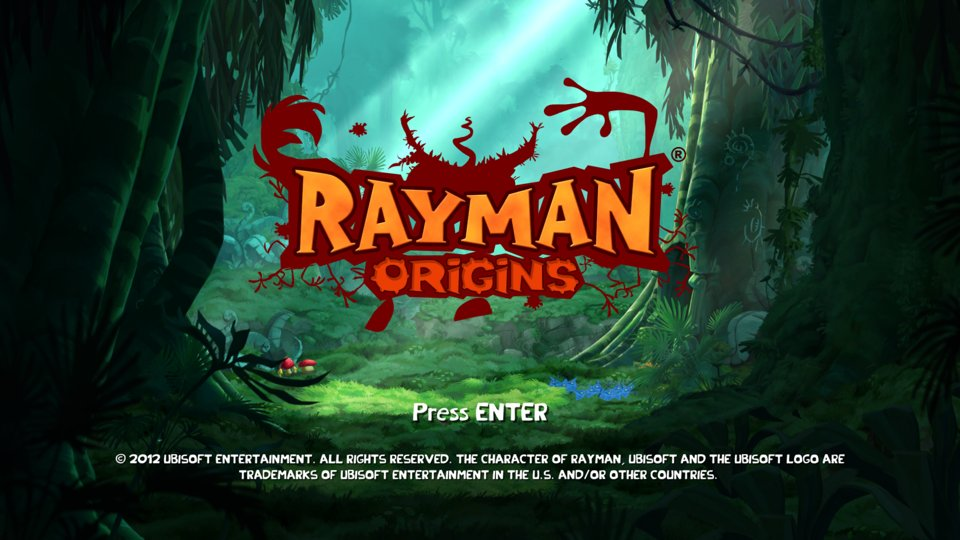
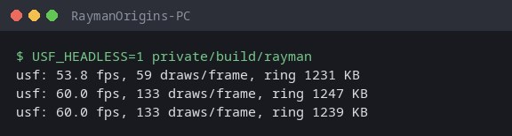
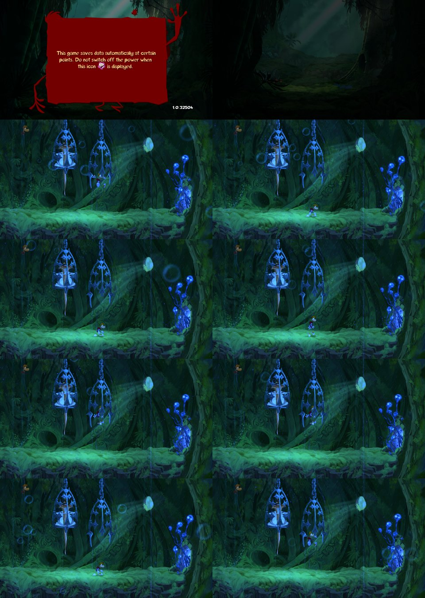
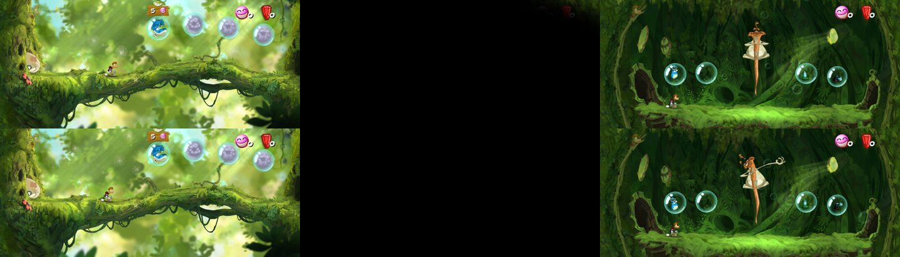
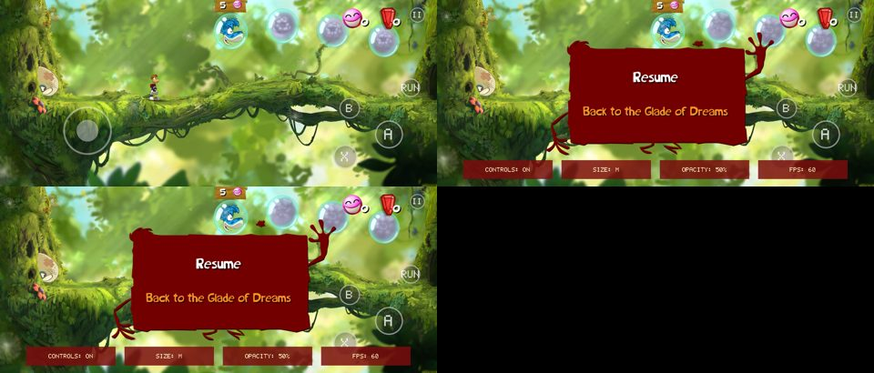
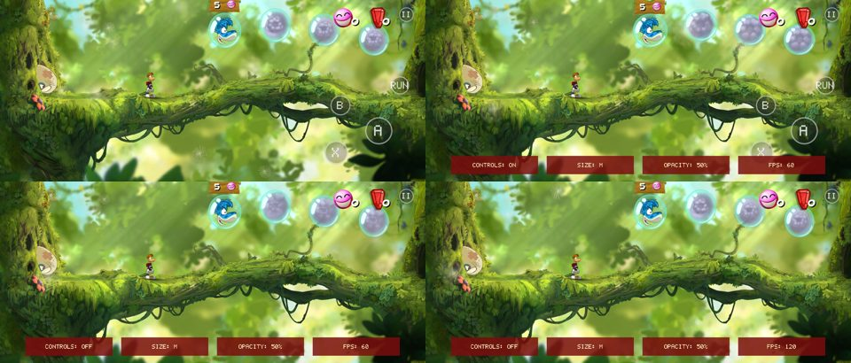
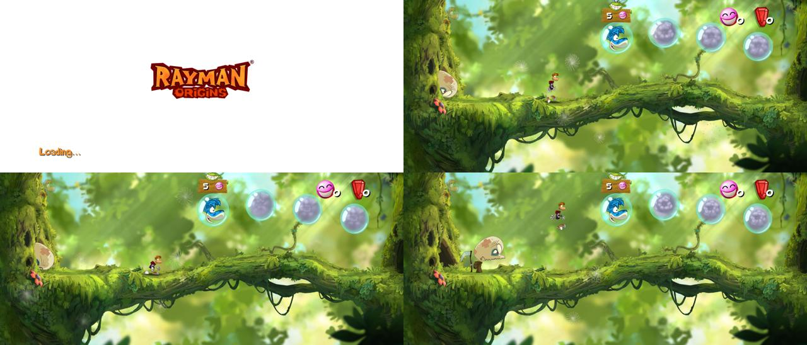
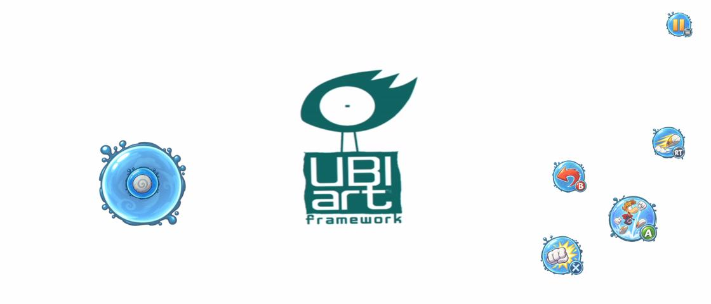
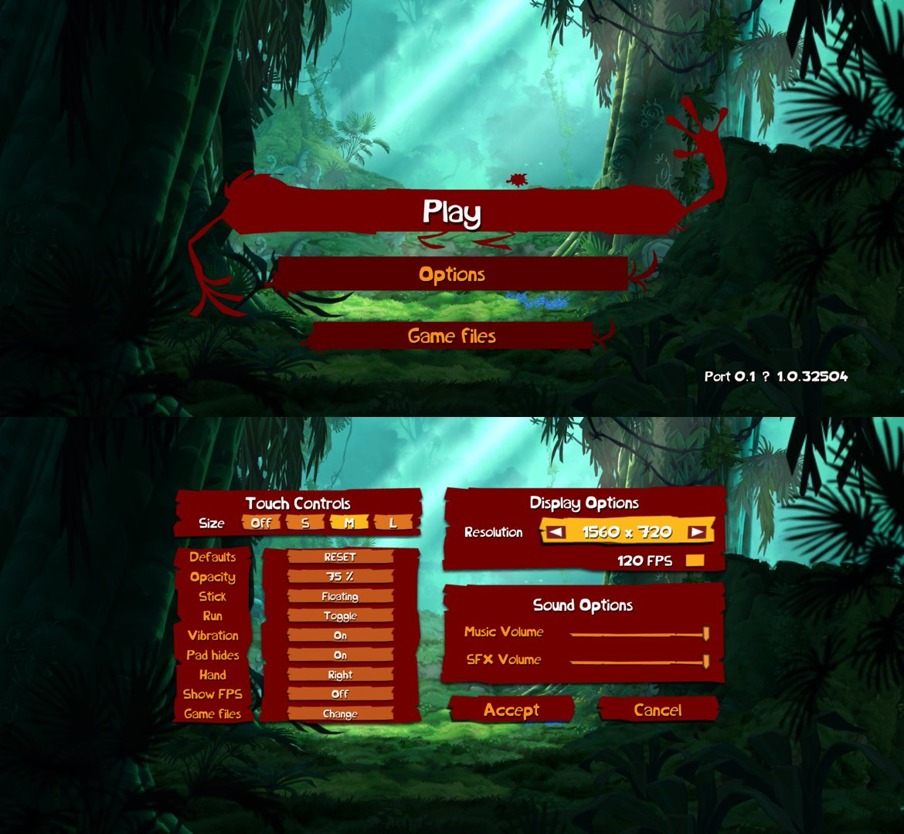
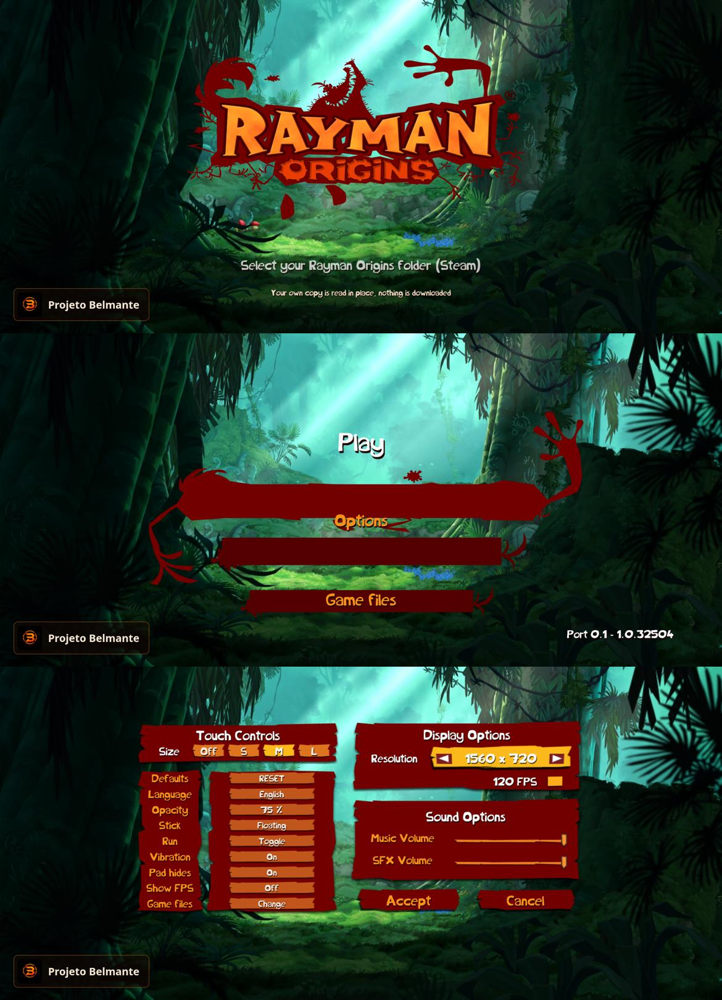

# Progress

## 2026-11-15 — Repository and first read of the executable

Created the repository with the rules, the plan and the tools that carry over unchanged from USFIV-PC
(`check_repo.py`, `pe_info.py`, `term_shot.py`). Read `Rayman Origins.exe` and `GameData/`:
relocations present, dynamic MSVC 2008 runtime, no copy protection, UbiArt engine, shaders shipped as HLSL source.
Details: [studies/pe-analysis-1511.md](studies/pe-analysis-1511.md).

Next: run the game under Proton with a logging `d3dx9_43` to list the effect methods and shader profiles it uses, and
bring over the discovery and lift pipeline (M1).

## 2026-11-15 — M1 + M2: every function lifted, the game boots natively to its title screen at 60 fps

Verified on Linux x86-64 (Intel UHD, Vulkan 1.4), 2026-11-15: `Rayman Origins.exe` runs as recompiled C with our
own runtime, no Wine or Proton, and draws its title screen (animated logo, "Press ENTER") through the D3D9 → Vulkan
layer at 60 fps, ~132 draws per frame.

- **Discovery + lift (M1).** The USFIV-PC pipeline, plus a new seed source: the executable keeps its base
  relocations, and every relocated pointer into code that no function covers is a function start (thread routines
  and callbacks the other heuristics missed). 49,793 functions, 99.9 % of `.text`, all lifted; the C compiles for
  x86-64 and arm64.
- **C runtime.** The game links msvcr90/msvcp90 dynamically; ~190 imports are answered natively (printf/scanf
  formatting from guest arguments, stdio, the x87 `_CIxxx` helpers that take their arguments on the FPU stack,
  start-up, `std::string`). `__sys_nerr` is a function returning a pointer, not data (found by the crash it caused).
- **Shaders without an HLSL compiler.** The game compiles 31 functions of its `*_Register.fx` sources with
  `D3DXCompileShader` at start-up. The archive carries the same functions precompiled
  (`shaders/compiled/win32/<file>_vsh<N>.ckd`, `_psh<N>.ckd`), numbered in the order the game compiles them; every
  one was matched by its constant table (e.g. `renderpct_vsh4` = `default_PCT_Patch_VS`: the only one with
  `g_va0`/`g_va1` and `g_fconst1`). The runtime reads them from `bundle_PC.ipk` (runtime/src/ipk.c).
- **Input.** The game polls `GetKeyState` for all 256 keys and tests `& 0x80`: a pressed key must read as `0xFF80`
  (Windows' real value), not `0x8000`.
- **Settings** live in the registry (`HKCU\Software\Ubisoft\RaymanOrigins\Settings`): a text file in our data folder.

Not done yet: Bink movies (skipped), MS ADPCM sounds (added, not checked by ear), gameplay past the title.

## 2026-11-15 — M3 (first part): gameplay, natively, at 60 fps

Verified on Linux x86-64, 2026-11-15, unattended (`USF_INPUT` presses Enter / Space every 2 s): past the title, the
save notice and the intro, into the first level, with Rayman jumping, rain, light shafts and the HUD drawn right, at
60 fps (~72 draws per frame). The one stop on the way was a second entry point inside an already known function
(`0x90AB20`, reached through a function pointer); the runtime wrote it to `extra_starts.txt` and the pipeline,
now incremental (output files grouped by `.text` range, rebuilt only when they change), took 6.5 minutes.

Next: Bink movies through FFmpeg (the intro is skipped now), checking the sound by ear, a whole level with a pad.

## 2026-11-15 — Ultrawide in a window, 60 fps paced, sound

Verified on Linux x86-64 (1920x1080 144 Hz laptop), 2026-11-15:

- **Ultrawide (Hor+).** UbiArt fits its cameras and screen rectangles to a 16/9, 9/16 pair of floats in `.rdata`
  (`0xA2C1B4`; the Xbox 360 port changes the same pair). At start-up both become A and 1/A, A = the back buffer's
  shape: the view gets wider and the engine places its own HUD (the lums and gems counters at the right edge
  above). The USFIV-PC 2D narrowing and its SSFIV addresses are off.
- **Window.** The game reads `ScreenWidth`, `ScreenHeight` (strings) and `FullScreen` (dword) from its registry key;
  the runtime answers them: 1920x822 (21:9 on a 1920-wide desktop) windowed, `RAYMAN_RES=WxH`,
  `RAYMAN_FULLSCREEN=1`.
- **60 fps on any display.** The game advances one step per presented frame (the 360 port found the same), so
  Present is paced at 60 per second (`RAYMAN_FPS`); a late frame restarts the schedule rather than catching up.
  Without it this 144 Hz screen would run the game 2.4 times too fast.
- **Sound.** XAudio2 with MS ADPCM decoding. 60 s of the mix dumped (`USF_AUDIO_DUMP`): peaks 0.3–0.5, no NaN,
  1,000–6,000 zero crossings per second (music and effects, not noise). Not yet checked by ear.
- **Exit.** The game's shutdown crashes in the destructor of an online-layer object (`0x8F8660`); after the player
  closes the window a fault ends the process normally (saves are made at checkpoints). The cause is still open.

## 2026-11-15 — Discovery from relocations only, Bink movies, real 120 fps, unattended soak

**Discovery.** Two kinds of false function starts were found by looking at why `0x746150` was missed: dwords in
`.data` that only look like code addresses ("vtable" starts at `0x746153`, `0x74616D`, inside the real function),
and relocated jump-table addresses inside instructions (`jmp [eax*4+table]`). Now a data dword is a pointer only if
the linker relocated it, and a relocation in code is a function pointer only as the immediate of `push` / `mov`.
45,190 functions (the 4,600 fewer were false ones); every start the runtime had reported during play
(`0x8BB4A0`, `0x90AB20`, `0x746150`) is now found statically.

**Soak.** `tools/soak.sh`: the game headless with a "monkey" (Enter through menus, then hold right, jump, attack).
30,000 frames (8 min): the first level several times, the world map, a second level; no stop.

**Bink movies.** The game's player was read from its code (0x7FF750..0x7FFAB8): it locks its own L8 textures,
registers them as Bink frame buffers (Y, cR, cB per set at +0x18, 0x30 bytes a set), calls BinkWait / BinkDoFrame /
BinkGetRects every frame and ends when BinkGetSummary's TotalPlayedFrames reaches TotalFrames. hle_bink.c does that
with FFmpeg (it decodes Bink 1, 1280x720 at 29.97 fps, and Bink audio) on a decoding thread, sound on its own SDL
stream. Colors correct (cR = V, cB = U), sound present (peaks 0.39).

**120 fps, real.** The engine has its own frame rates (strings "Game logic 30/50/60fps", "App loop ..."):
`SetFrameRate` (0x796E60) and `SetLogicRate` (0x796E80) write fps and 1/fps to `.data 0xA8A9D8..E4`; the logic step
(`0xA8A9E4`) is read in 65 places. `RAYMAN_FPS=120` sets all four and paces Present at 120: 120 logic steps per
second, not interpolated frames. Checked: the same script at 60 and at 120 fps (every input frame doubled) puts
Rayman in the same place at the same real time (top 60, bottom 120):

## 2026-11-15 — On-screen controls and the port's settings, in the game, by touch

Verified on the PC with the touch layer on (`RAYMAN_TOUCH=1`) and scripted fingers (`USF_TOUCH`), 2026-11-15:

- **In play only the controls show**: a floating stick where the left thumb lands, A (jump), X (attack), B, a RUN
  toggle and a pause button. Fingers become the same pad bits the game already reads (its keyboard through
  `GetKeyState` and its DirectInput pad). Drawn by the runtime: `touch.c` paints an RGBA picture (shapes and a
  built-in 5x7 font), `vk/vk_overlay.c` blends it over the back buffer (one full-screen triangle, premultiplied
  alpha), only re-uploaded when it changes.
- **Pause** sends Esc + Start: the game opens its own pause menu, and the port's settings appear under it, also by
  touch: on-screen controls on/off, size S/M/L, opacity 25/50/75 %, 60 / 120 fps. Kept in `port_settings.txt`
  in the data folder. With the controls off, only the pause button stays (it is the way back to the settings).
- **Resolution** stays where the game has it: the PC build's own Options have a resolution selector, filled from
  `IDirect3D9::EnumAdapterModes`, which the runtime answers.
- Found on the way: the keyboard was also mirrored into the DirectInput pad with USFIV's fighting layout
  (W/A/S/D, J/K/U/I), so a key could count twice; the pad is now the physical gamepad only.

## 2026-11-15 — Android build; settings change live; a note on measurements

- Android: `tools/android/build_ffmpeg.sh` (Bink only), `build_native.sh`, `build_apk.sh` produce
  `rayman-origins-pc.apk` (arm64, signed, verified; no unresolved strong symbols). Not run on a phone: none was
  connected. See [ANDROID.md](ANDROID.md).
- The fps setting is read every frame, so 60 / 120 from the touch settings applies at once (it was read only at
  start-up).
- A 50,000-frame soak ran at ~16 fps and a later check at ~37 fps: three USFIV-PC test runs of another session were
  using the CPU and the shared GPU at the same time. With the machine free the same runs hold 60 fps (earlier
  entries). Measurements are only meaningful on an idle machine.

## 2026-11-15 — USB / Bluetooth controllers: the game reads them as XInput pads

- Report: a USB pad (a generic "Zikway HID gamepad") did nothing in the game, although SDL saw it and its buttons
  reached the DirectInput device (`USF_PADLOG=1` shows them).
- Cause, in the game's code: the pad manager (vtable 0x9F1ED8) enumerates DirectInput game controllers and first
  asks **WMI** for PnP devices whose DeviceID has `IG_` (Microsoft's IsXInputDevice sample, 0x4B60C0). A pad whose
  guidProduct matches one of them is an XInput pad (read with `XInputGetState`, 0x4B6C60); any other is read with
  DirectInput. The default controls (0x4B4F91) are set **only for XInput pads**: a DirectInput pad has no mapping
  and is ignored. Our CoCreateInstance had no WMI, so no pad was ever XInput and `XInputGetState` was never called.
- Fix: `hle_wmi.c` answers `CLSID_WbemLocator` with one Win32_PNPEntity of an Xbox 360 pad
  (`VID_045E&PID_028E&IG_00`), and the DirectInput pad carries that guidProduct. The game now reads player 1 with
  `XInputGetState(0)`, which is any SDL gamepad (Xbox, PlayStation, Switch, generic), plugged before or after start.
- With an XInput pad the game no longer reads the keyboard itself, so the keyboard is folded into pad 0 in the
  game's PC layout: arrows, Space / Enter = jump / confirm, S = attack, Shift = run, Backspace = back, Esc = pause.
- Checked: a 6,000-frame scripted run reaches a level and plays through the XInput path only.

## 2026-11-19 — Direct3D 9 through DXVK native (the renderer from now on)

- The own D3D9 → Vulkan layer stuttered (frames of 90+ ms). As in the Sonic & All-Stars Racing Transformed PC port,
  the game's Direct3D 9 now goes to **DXVK 3.1.1 built as a native Linux library** (`private/deps/dxvk`,
  `build-native`, D3D9 only, SDL3 window system). The bridge (`runtime/src/d3d9/dxvk_bridge.c`, `dxvk_sigs.c`,
  `dxvk_d3dx.c`, from that port; `dxvk_glue.c` for this runtime) wraps each DXVK object in a guest object, converts
  arguments by each method's signature and hands locks a guest copy.
- Kept from this port: Hor+ aspect at CreateDevice / Reset, the 60 / 120 fps pacer and engine rates after Present
  (DXVK's limiter off), `D3DXCreateTexture` through the device (DXT sizes rounded up to 4x4 blocks as D3DX does: DXVK
  refuses a 2x1 DXT1 texture, and the game then crashed on the null texture), `D3DXLoadSurfaceFromMemory` through
  LockRect.
- Verified (headless): Bink logos, menu, first level at 21:9; the RTX 3050 is used (the own layer only saw the Intel).
- **Frame times**, level, 120 fps, power-saver, same scripted input (`RAYMAN_FTLOG`):

  | | own renderer | DXVK |
  |---|---|---|
  | mean fps | 115.9 | 119.0 |
  | frame-time std dev | 2.72 ms | 0.91 ms |
  | p99 | 15.6 ms | 11.0 ms |
  | worst | 93.5 ms | 17.9 ms |
  | frames over 16.7 ms | 24 | 4 |

## 2026-11-19 — Touch controls with the Xbox 360 port's drawings, drawn through DXVK

- The on-screen controls now use the themed drawings made for the Xbox 360 port (jump, attack, back, run, pause, stick
  base and knob; `runtime/assets/touch/`). `tools/touch_art.py` scales them to 256x256 premultiplied RGBA
  (`private/include/touch_art.rgba`, made by the build scripts) and `touch_art.c` embeds that block; `touch.c` draws
  them bilinear, lighter and a little smaller while pressed. Opacity steps are now 50 / 75 / 100 %.
- The layer is blended by `dxvk_overlay.c`: on DXVK's device, a dynamic texture refilled only when the picture changes
  and one fixed-function quad before Present, with the game's state saved in a state block and its render target and
  depth buffer put back.

## 2026-11-19 — Android with DXVK: runs on the Galaxy S23

- The APK now carries `libdxvk_d3d9.so` built by `tools/android/build_dxvk_mobile.sh` (dxvk-native 1.9.2b with
  mobile-GPU patches, SDL3 window system, Vulkan 1.1; the build the Sonic & All-Stars Racing Transformed port runs on
  the S23). The runtime loads it next to `libmain.so` through the same bridge as on the PC.
- Installed on the Galaxy S23 with the game folder in `Games/RaymanOrigins`: **the user played it, it runs well**,
  with the drawn touch controls.

## 2026-11-22 — A launcher in the game's own look (HTML mock-up)

- Studied the PC build's title menu (`scene/menus/mainmenu`: buttons from the `bubblemenu_a` atlas animated by a
  skeleton, the scene `menumainbackground_v2`) and its Options screen (`scene/menus/inputconfiguration`: plain 2D
  textures for panels, fields, arrows, sliders, check box; text in `font02.fnt`).
- `USF_HIDE_TEX=<w>x<h>x<format>,...` (analysis, in the DXVK bridge) skips draws whose stage-0 texture matches: with
  the menu atlas (1024x512 DXT3) and the font (1024x1024 DXT3) hidden, the game renders the jungle behind its menu,
  and with only the font hidden, the bars without text. The captures (2340x1080, the S23's shape) are deterministic,
  so bars minus scene gives each carousel slot as a picture.
- `tools/launcher_mock.py` + `tools/launcher_mock.html` build `private/launcher/launcher.html` (game pictures from the
  user's copy, so it stays in private/): the home is the game's scrolling bars with the port's entries (Play, Options,
  Game files, Quit Game); the settings are the game's Options screen with the port's settings (touch controls size,
  opacity, stick, run, vibration...; resolution, 120 fps; volumes; Accept / Cancel). Keyboard, mouse and touch.
  Positions are measured on the game's own screens; text uses the game's font and colours.

## 2026-11-22 — The launcher mock-up plays the game's own animations (no recording)

- The title logo and the menu's bars are UbiArt skeleton animations: pieces of an atlas, each drawn as a cubic Bezier
  patch by the game's `default_PCT_Patch_VS` (the HLSL is in the archive, `shaders/unified/renderpct.fx`): 8 control
  points per patch (position xy, UV zw) from c17, corner colours from c145, the matrix in c0..c3.
- `USF_GEO_DUMP=<file>` + `USF_GEO_TEX=#<hash>,...` (`runtime/src/d3d9/dxvk_geodump.c`) writes, for each draw of
  those textures, the constants and the patch grid. Textures are named by a hash of their level 0 (taken at Unlock,
  through GetSurfaceLevel and UpdateTexture too); `USF_HIDE_PS` / `USF_HIDE_TEX(_ODD)` / `USF_SHOT_RUN` are the other
  capture aids.
- `tools/geo_anim.py` turns a dump into one loop (logo: 121 frames, bars: 90, found where the patches repeat
  exactly), 30 frames a second, gzip: 224 KB and 74 KB. The mock-up evaluates the same Bezier patches in WebGL over the
  game's atlases, so the animation is the game's, sharp at any size.
- Mock-up now: the title screen (animated logo) asks for the Steam folder; the menu with the animated bars and hand;
  the settings with a Language row; the menu theme (`sound/300_music/310_common/mus_menu_main.wav`, from the archive,
  looped); "Projeto Belmante" with the channel logo at the bottom left. App icon: `runtime/assets/app_icon.png` (fan
  art from SteamGridDB, chosen by the user).
- Seen on the way: the NVIDIA driver failed (kernel `NVRM` RPC errors, `VK_ERROR_DEVICE_LOST` in DXVK, GPU gone until a
  reboot); the captures were finished on the Intel GPU (`VK_ICD_FILENAMES=.../intel_icd.json`).

## 2026-11-22 — Android launcher in Java in the game's look; language; crash reports

- **Launcher** (`GameMenu.java`, `MenuArt.java`, `MenuText.java`; no WebView): a View drawing a 2340x1080 stage scaled
  to the screen. Title screen with the game's animated logo asking for the Steam folder; the menu with the animated
  bars and hand (Play, Options, Game files, Quit Game); the settings on the game's Options screen; the menu theme in a
  loop (MediaPlayer); "Projeto Belmante" on the game's red plank. The animations are the game's Bezier patches drawn
  with `Canvas.drawVertices` over the atlases; text in the game's font. Touch, pad (d-pad, A/Start, B/Back) or keys.
  Its art comes from the player's copy (`tools/launcher_mock.py` writes `private/launcher/apk/launcher/`;
  `build_apk.sh` packs it: personal builds); without it the plain launcher stays. App icon: `runtime/assets/app_icon.png`.
- **Settings** go to `port_settings.txt` (the launcher keeps the runtime's own keys and vice versa): touch / size /
  opacity (touch.c), `lines` (the resolution, hle_advapi.c), `lang`, volumes, stick, run, vibration...; 120 fps hidden.
- **Language**: the game reads `HKLM\SOFTWARE\Ubisoft\RaymanOrigins\Settings\Language` (a DWORD, its own numbers:
  `localisation.loc` has 0 en, 1 fr, 2 ja, 3 de, 4 es, 5 it, 8 pt, 10 pl, 11 ru, 12 nl, 13 cs, 14 hu); the runtime
  answers it from `lang=`. Checked: lang French -> the title reads "Appuie sur ENTRÉE.". The launcher's own texts follow
  (8 translations; Czech, Hungarian and Japanese show English there).
- **Crash on the phone** (a level closed by itself): Android's exit info shows the game process killed by SIGSEGV
  (rss 1.5 GB), with no tombstone, because the runtime's fault handler reset the signal to the default. Now a fault
  is written to logcat and `<data>/crash.txt` (native pc, lifted function, stack) and then handed to Android's own
  handler (tombstone). The cause itself needs that report from the next crash.

