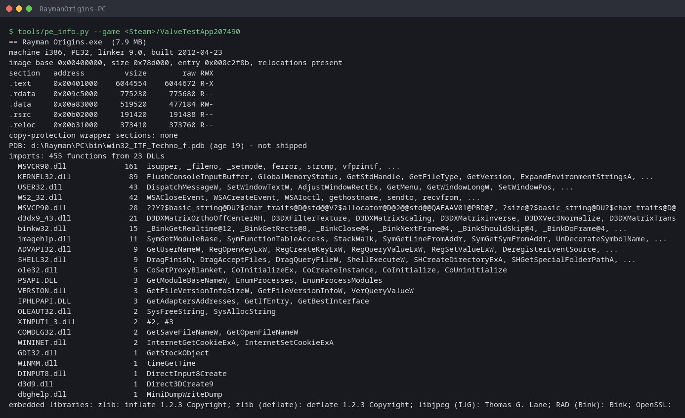

# Progress

## 2026-11-15 — Repository and first read of the executable

Created the repository with the rules, the plan and the tools that carry over unchanged from USFIV-PC
(`check_repo.py`, `pe_info.py`, `term_shot.py`). Read `Rayman Origins.exe` and `GameData/`:
relocations present, dynamic MSVC 2008 runtime, no copy protection, UbiArt engine, shaders shipped as HLSL source.
Details: [studies/pe-analysis-1511.md](studies/pe-analysis-1511.md).

Next: run the game under Proton with a logging `d3dx9_43` to list the effect methods and shader profiles it uses, and
bring over the discovery and lift pipeline (M1).

## 2026-11-15 — M1 + M2: every function lifted, the game boots natively to its title screen at 60 fps

Verified on Linux x86-64 (Intel UHD, Vulkan 1.4), 2026-11-15: `Rayman Origins.exe` runs as recompiled C with our
own runtime, no Wine or Proton, and draws its title screen (animated logo, "Press ENTER") through the D3D9 → Vulkan
layer at 60 fps, ~132 draws per frame.

- **Discovery + lift (M1).** The USFIV-PC pipeline, plus a new seed source: the executable keeps its base
  relocations, and every relocated pointer into code that no function covers is a function start (thread routines
  and callbacks the other heuristics missed). 49,793 functions, 99.9 % of `.text`, all lifted; the C compiles for
  x86-64 and arm64.
- **C runtime.** The game links msvcr90/msvcp90 dynamically; ~190 imports are answered natively (printf/scanf
  formatting from guest arguments, stdio, the x87 `_CIxxx` helpers that take their arguments on the FPU stack,
  start-up, `std::string`). `__sys_nerr` is a function returning a pointer, not data (found by the crash it caused).
- **Shaders without an HLSL compiler.** The game compiles 31 functions of its `*_Register.fx` sources with
  `D3DXCompileShader` at start-up. The archive carries the same functions precompiled
  (`shaders/compiled/win32/<file>_vsh<N>.ckd`, `_psh<N>.ckd`), numbered in the order the game compiles them; every
  one was matched by its constant table (e.g. `renderpct_vsh4` = `default_PCT_Patch_VS`: the only one with
  `g_va0`/`g_va1` and `g_fconst1`). The runtime reads them from `bundle_PC.ipk` (runtime/src/ipk.c).
- **Input.** The game polls `GetKeyState` for all 256 keys and tests `& 0x80`: a pressed key must read as `0xFF80`
  (Windows' real value), not `0x8000`.
- **Settings** live in the registry (`HKCU\Software\Ubisoft\RaymanOrigins\Settings`): a text file in our data folder.

Not done yet: Bink movies (skipped), MS ADPCM sounds (added, not checked by ear), gameplay past the title.

## 2026-11-15 — M3 (first part): gameplay, natively, at 60 fps

Verified on Linux x86-64, 2026-11-15, unattended (`USF_INPUT` presses Enter / Space every 2 s): past the title, the
save notice and the intro, into the first level, with Rayman jumping, rain, light shafts and the HUD drawn right, at
60 fps (~72 draws per frame). The one stop on the way was a second entry point inside an already known function
(`0x90AB20`, reached through a function pointer); the runtime wrote it to `extra_starts.txt` and the pipeline,
now incremental (output files grouped by `.text` range, rebuilt only when they change), took 6.5 minutes.

Next: Bink movies through FFmpeg (the intro is skipped now), checking the sound by ear, a whole level with a pad.
