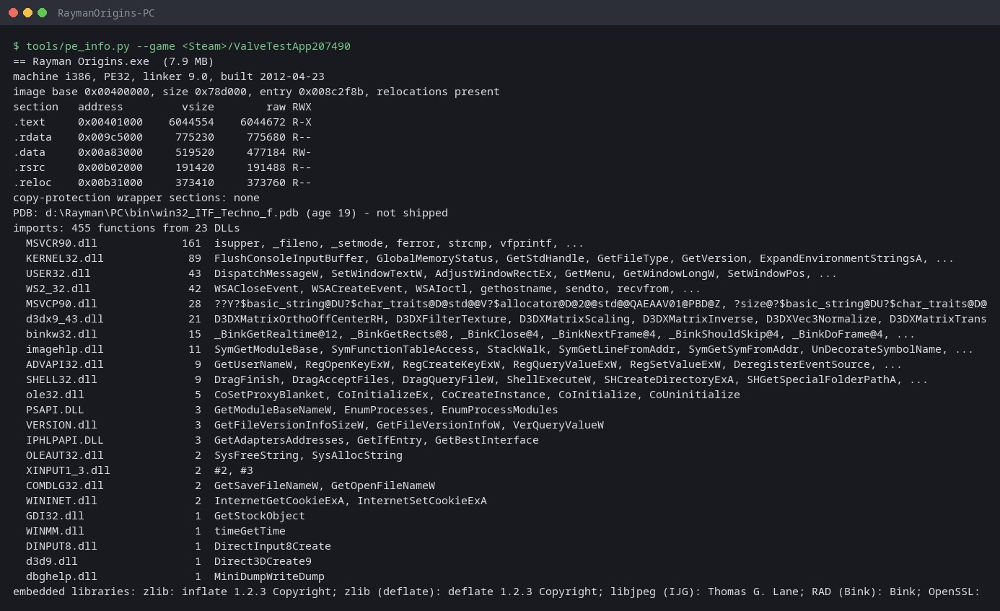

# First read of the PC build (15/11)

What the Windows executable is made of, and what each part means for the recompilation.

Command (verified on Linux x86-64, 2026-11-15):

```
.venv/bin/python -I tools/pe_info.py --game ~/.local/share/Steam/steamapps/common/ValveTestApp207490
```



## The executable

| Fact | Value | Consequence |
|---|---|---|
| Format | PE32 i386, MSVC 2008 (linker 9.0), built 2012-04-23 | Same compiler family as USFIV-PC (MSVC 2010): the lifter's x86/x87/SSE coverage carries over |
| Image base | `0x00400000`, entry `0x008C2F8B` | Guest memory in the low 4 GB, 32-bit pointers, as in USFIV-PC |
| Relocations | **Present** (`.reloc`, 365 KB) | Every absolute pointer in code and data is listed: exact function-pointer tables, safer discovery than USFIV (which had them stripped) |
| Sections | `.text` 5.8 MB, `.rdata` 0.75 MB, `.data` 0.5 MB, `.rsrc`, `.reloc` | `.text` entropy 6.56: not packed |
| Protection | No wrapper section, no `steam_api` import, no DRM strings | Nothing to stop the work (rule 8) |
| PDB | `d:\Rayman\PC\bin\win32_ITF_Techno_f.pdb`, not shipped | "ITF" = UbiArt Framework, the engine of the Xbox 360 port |
| C runtime | **Dynamic**: MSVCR90 (161 imports), MSVCP90 (28) | `strcmp`, `malloc`, threads… are imports: answered by the host libc, not recompiled |
| RTTI | 185 classes, mostly `Quazal::` | Quazal Rendez-Vous is the online layer: stubbed offline |
| Embedded | zlib 1.2.3, libjpeg, OpenSSL, Quazal | |

## Imports and what answers them

| DLL | Count | Plan |
|---|---|---|
| KERNEL32, USER32, ADVAPI32, SHELL32, GDI32, WINMM, VERSION, PSAPI | 158 | USFIV-PC runtime (`hle_k32_*`, `hle_user32`), extended |
| MSVCR90 / MSVCP90 | 189 | New: thin wrappers over the host libc / a small `std::string` shim |
| d3d9 | 1 (`Direct3DCreate9`) | USFIV-PC D3D9 → Vulkan layer |
| d3dx9_43 | 21 | Math: trivial. `D3DXCompileShader`, `D3DXCreateEffect`, `D3DXCreateTexture`, `D3DXFilterTexture`: new (see below) |
| DINPUT8, XINPUT1_3 (`#2` GetState, `#3` SetState) | 3 | USFIV-PC `hle_dinput`, `hle_xinput` |
| ole32 (`CoCreateInstance`) | 5 | XAudio2 (the exe has `SoundAdapter_XAudio`): USFIV-PC `hle_xaudio2` |
| binkw32 | 15 | x86 DLL, cannot run on ARM: replaced by FFmpeg (it decodes Bink), as the USFIV-PC movies |
| WS2_32, IPHLPAPI, WININET | 47 | Offline stubs (USFIV-PC `hle_net`) |
| imagehlp, dbghelp, COMDLG32 | 14 | Crash reporting / editor dialogs: stubs |

## The data

`GameData/` holds one archive, `bundle_PC.ipk` (2.1 GB), and four Bink movies (`intro`, `cine_fin`, `rolling_demo`,
`sample`). The `.ipk` starts with `50 EC 12 BA`, the UbiArt IPK magic also used by the Xbox 360 build.

## The new problem: shaders are HLSL source

The archive carries the shaders as **HLSL effect source** (`Shaders/Unified/*.fx`, with `technique` blocks; names
such as `AfterFx`, `font`, `movie`, `refract`, `renderPCT`, `renderFOG`). The game compiles them at run time with
`D3DXCreateEffect` / `D3DXCompileShader` (targets `vs_2_0` / `ps_2_0` seen in the exe). USFIV-PC never needed this.

Plan (not verified yet):
1. Compile HLSL to D3D9 bytecode with **vkd3d-shader** (it has an HLSL → d3dbc SM1–3 back end; Wine's d3dx9 uses it).
2. Implement only the `ID3DXEffect` methods the game calls (Wine's `d3dx9_36/effect.c` as the reference).
3. Feed the bytecode to the USFIV-PC D3D9 → SPIR-V translator.
4. On Android, compile every `.fx` once at import time and keep a cache.

To find out which effect methods and shader profiles are really used: run the game once under Proton with a logging
`d3dx9_43` (next step).

## Conclusion

The PC build is a friendlier target than USFIV-PC: relocations present, dynamic CRT, no DRM. Almost all of the
pipeline and runtime can be reused. The one large new piece is the D3DX effect/HLSL path.
